# DOCUMENTACIÓN TÉCNICA INTEGRAL
# ANÁLISIS Y DISEÑO DE SISTEMAS E INGENIERÍA DEL SOFTWARE
## TechStock – Sistema Centralizado de Gestión de Inventario de Productos Tecnológicos

**Institución:** Servicio Nacional de Adiestramiento en Trabajo Industrial (SENATI)  
**Carrera profesional:** Ingeniería de Software con Inteligencia Artificial / Tecnologías de la Información  
**Curso:** Análisis y Diseño de Sistemas / Ingeniería del Software  
**Docente:** `[Pendiente de definir]`  
**Estudiante:** Estudiante de Ingeniería del Software `[Pendiente de definir nombre completo]`  
**Sección:** `[Pendiente de definir]`  
**Entorno Tecnológico:** PHP 8.2+ / Laravel 12.0 / MySQL 8.4 & SQLite / Blade / Tailwind CSS v4 / Sistema de Diseño Editorial (`DESIGN.md`)  
**Fecha:** 1 de noviembre de 2026

---

## ÍNDICE GENERAL

### PARTE I. ENTREGABLE TRABAJO FINAL DEL CURSO: INGENIERÍA DEL SOFTWARE (FORMATO SENATI)
* [1. Introducción y Diagnóstico del Caso](#1-introducción-y-diagnóstico-del-caso)
  * [1.1. Contexto Problemático](#11-contexto-problemático)
  * [1.2. Solución Implementada](#12-solución-implementada)
* [2. Respuestas a las Preguntas Guías](#2-respuestas-a-las-preguntas-guías)
  * [Pregunta 1: Priorización MoSCoW](#pregunta-1-cómo-priorizarías-los-requerimientos-de-techstock-usando-técnicas-como-moscow)
  * [Pregunta 2: Diagramas UML Esenciales](#pregunta-2-qué-diagramas-uml-serían-esenciales-para-modelar-la-interacción-entre-usuarios-y-el-sistema)
  * [Pregunta 3: Escalabilidad del Sistema](#pregunta-3-cómo-garantizarías-la-escalabilidad-del-sistema-si-techstock-duplica-su-catálogo-y-operaciones-en-1-año)
  * [Pregunta 4: Métricas de Calidad (ISO/IEC 25010)](#pregunta-4-qué-métricas-de-calidad-incluirías-en-las-pruebas-del-sistema)
  * [Pregunta 5: Principios de UX/UI para Baja Alfabetización Digital](#pregunta-5-qué-principios-de-uxui-aplicarías-para-que-la-interfaz-sea-intuitiva-para-empleados-con-baja-alfabetización-digital)
* [3. Diagramas y Modelado del Software](#3-diagramas-y-modelado-del-software)
  * [3.1. Diagrama de Casos de Uso (UML)](#31-diagrama-de-casos-de-uso-uml)
  * [3.2. Diagrama de Clases del Dominio (UML)](#32-diagrama-de-clases-del-dominio-uml)
  * [3.3. Diagrama de Actividades: Movimiento Atómico con Bloqueo Pesimista (UML)](#33-diagrama-de-actividades-movimiento-atómico-con-bloqueo-pesimista-uml)
  * [3.4. Diagrama BPMN: Flujo de Detección de Alerta y Reposición de Stock](#34-diagrama-bpmn-flujo-de-detección-de-alerta-y-reposición-de-stock)
* [4. Estructura y Validación de la Solución Técnica](#4-estructura-y-validación-de-la-solución-técnica)
  * [4.1. Módulos y Endpoints del Sistema](#41-módulos-y-endpoints-del-sistema)
  * [4.2. Resultados de la Suite de Pruebas Automatizadas](#42-resultados-de-la-suite-de-pruebas-automatizadas)
* [5. Conclusiones y Recomendaciones Ejecutivas](#5-conclusiones-y-recomendaciones-ejecutivas)

### PARTE II. DOCUMENTACIÓN TÉCNICA: ANÁLISIS Y DISEÑO DE SISTEMAS (8 CAPÍTULOS + ANEXOS)
* [INTRODUCCIÓN](#introducción)
* [CAPÍTULO I. ASPECTOS GENERALES](#capítulo-i-aspectos-generales)
* [CAPÍTULO II. ANÁLISIS DEL SISTEMA](#capítulo-ii-análisis-del-sistema)
* [CAPÍTULO III. DISEÑO DEL SISTEMA](#capítulo-iii-diseño-del-sistema)
* [CAPÍTULO IV. MODELADO DE PROCESOS Y DATOS](#capítulo-iv-modelado-de-procesos-y-datos)
* [CAPÍTULO V. DISEÑO DE LA BASE DE DATOS](#capítulo-v-diseño-de-la-base-de-datos)
* [CAPÍTULO VI. PROCESOS Y REGLAS DE NEGOCIO](#capítulo-vi-procesos-y-reglas-de-negocio)
* [CAPÍTULO VII. SEGURIDAD Y VALIDACIÓN DEL SISTEMA](#capítulo-vii-seguridad-y-validación-del-sistema)
* [CAPÍTULO VIII. CONCLUSIONES Y RECOMENDACIONES](#capítulo-viii-conclusiones-y-recomendaciones)
* [REFERENCIAS](#referencias)
* [ANEXOS (Anexo A, Anexo B y Anexo C: Modelado UML Completo)](#anexos)

> **Nota de navegación:** Al abrir o importar este documento en Microsoft Word o procesadores compatibles, puede generarse una tabla de contenido automática aplicando los estilos de encabezado `H1`, `H2` y `H3`.

---

# PARTE I. TRABAJO FINAL DEL CURSO: INGENIERÍA DEL SOFTWARE
## Tecnologías de la Información — SENATI
### Sistema Centralizado de Gestión de Inventarios en Tiempo Real para TechStock

**Autor:** Estudiante de Ingeniería del Software  
**Entorno Tecnológico:** PHP 8.2+ / Laravel 12.0 / MySQL 8.4 & SQLite / Blade / Tailwind CSS v4 / Sistema de Diseño Editorial (`DESIGN.md`)

---

## 1. Introducción y Diagnóstico del Caso

### 1.1. Contexto Problemático
**TechStock** comercializa y distribuye equipamiento tecnológico de alta rotación y elevado valor unitario en soles (`S/`), abarcando familias de **Computadoras** (*Dell Ryzen7*, *Lenovo Loq*, *Toshiba Satellite*), **Consolas** (*Nintendo Switch*, *Play Station 5*), **Periféricos** (*Teclado RGB Alienware*) y **Televisores** (*Samsung Oled*), abastecidos por proveedores mayoristas y retail (*Falabella*, *Ripley*, *Tottus*). Previo a la implantación del sistema, el control de existencias dependía de hojas de cálculo aisladas y registros manuales no sincronizados, ocasionando problemas operativos críticos:

* **Descalces entre el stock físico y el registro contable:** La ausencia de transacciones atómicas y de un kardex inmutable impedía reconstruir qué operación originó una variación de existencias (sin registro de `stock_anterior` ni `stock_posterior`).
* **Detección tardía de quiebres de stock y artículos bajo mínimo:** Equipos de alta demanda quedaban agotados (`stock = 0`, como *Play Station 5*) o por debajo del umbral de seguridad (`stock = 3` frente a `stock_minimo = 5`, como *Dell Ryzen7*) sin alertas tempranas ni cálculo automático del déficit de reposición.
* **Riesgo de existencias negativas por salidas no validadas:** Los despachos manuales no bloqueaban salidas que superaran las unidades físicamente disponibles.
* **Errores en cargas masivas de catálogo:** La incorporación de lotes de productos desde archivos externos carecía de validación de cabeceras, detección de códigos `SKU` duplicados, control de precios negativos y verificación de integridad referencial hacia categorías y proveedores.
* **Demoras en la valorización financiera del inventario:** Consolidar el capital inmovilizado ($\sum \text{Precio} \times \text{Stock}$) y el peso porcentual por categoría exigía cruces manuales propensos a error humano e inyección accidental de fórmulas en hojas de cálculo.

### 1.2. Solución Implementada
Se diseñó, construyó y verificó una aplicación web centralizada bajo el patrón **MVC transaccional en Laravel 12**, integrada por 9 módulos operativos y respaldada por las siguientes capacidades técnicas:

1. **Trazabilidad Atómica por Movimiento con Bloqueo Pesimista (`lockForUpdate`):** Cada entrada o salida se procesa dentro de `DB::transaction()` bloqueando la fila del producto (`Product::whereKey(...)->lockForUpdate()->firstOrFail()`), calculando y persistiendo de forma inmutable `stock_anterior`, `cantidad` y `stock_posterior` en la tabla `stock_movements`. Además, el alta de un producto con stock inicial $>0$ y cualquier edición manual de existencias generan automáticamente su asiento de auditoría.
2. **Criterio Determinista Único de Alerta y Cálculo de Déficit:** Todo el sistema evalúa la condición de stock bajo mediante el scope `Product::scopeLowStock()` ($\text{Stock Actual} \le \text{Stock Mínimo}$) y calcula el déficit exacto:
   $$\text{Déficit} = \max(0,\; \text{Stock Mínimo} - \text{Stock Actual})$$
3. **Motor de Importación CSV con Validación Fila por Fila:** Soporte nativo para archivos `.csv` y `.txt` (hasta 2 MB), eliminación de BOM UTF-8 (`\xEF\xBB\xBF`), autodetección de delimitador (`,` o `;`), mapeo flexible de cabeceras, validación en memoria de unicidad de `SKU` (en base de datos y dentro del mismo archivo), verificación de categorías/proveedores y asiento transaccional de inventario inicial.
4. **Analítica Financiera en Tiempo Real y Exportación CSV con Sanitización Anti-Fórmulas:** Cálculo instantáneo del valor estimado del inventario (`S/ 4,196,839.17` sobre las 893 unidades del catálogo semilla), distribución porcentual por categoría, ranking Top 10 de mayores existencias y exportación `StreamedResponse` con neutralización de caracteres ejecutables (`=`, `+`, `-`, `@`, `\t`, `\r`).
5. **Sistema de Diseño Editorial de Alta Precisión (`DESIGN.md`):** Interfaz construida bajo el concepto *"Pliego de Registro Editorial"* (modo claro) y *"Pliego de Carbón No Estucado"* (modo oscuro), con tipografía `Schibsted Grotesk` y `DM Mono`, alineación numérica tabular (`tabular-nums`), cruces de registro SVG (`+`) y sello circular de verificación.

---

## 2. Respuestas a las Preguntas Guías

### Pregunta 1: ¿Cómo priorizarías los requerimientos de TechStock usando técnicas como MoSCoW?

La técnica **MoSCoW** clasifica los requerimientos funcionales (`RF-01` a `RF-16`) y no funcionales (`RNF-01` a `RNF-10`) en cuatro niveles de prioridad para asegurar entregas incrementales con valor operativo inmediato desde el primer sprint:

| Categoría | Requerimiento | Justificación en TechStock |
| :--- | :--- | :--- |
| **Must Have**<br>*(Obligatorio para operar)* | 1. Autenticación privada por usuario/correo y protección de rutas con middleware `auth` (`RF-01`, `RF-02`, `RNF-01`).<br>2. CRUD de catálogo de productos con SKU único, categoría y proveedor con integridad referencial `restrictOnDelete` (`RF-04`, `RF-05`, `RF-08`, `RF-09`).<br>3. Registro transaccional de entradas y salidas con bloqueo pesimista `lockForUpdate()` e historial de `stock_anterior` y `stock_posterior` (`RF-10`, `RF-11`, `RNF-02`, `RNF-07`).<br>4. Detección determinista de alertas por umbral `stock <= stock_minimo` y cálculo de déficit (`RF-12`). | Constituye el núcleo transaccional del sistema. Sin control de acceso, integridad de catálogo, bloqueo de stock negativo y alertas de reposición, persiste el descontrol de inventario. |
| **Should Have**<br>*(Alta prioridad para el negocio)* | 1. Panel principal (Dashboard) con KPIs en tiempo real, valorización en `S/`, distribución por categoría y últimos 8 movimientos (`RF-03`).<br>2. Búsqueda combinada por nombre/SKU y filtros por categoría y stock bajo (`RF-06`).<br>3. Importación masiva de productos desde archivo CSV con validación fila por fila y reporte detallado de errores (`RF-07`, `RNF-10`).<br>4. Módulo de reportes analíticos y exportación CSV con sanitización contra inyección de fórmulas (`RF-13`, `RF-14`). | Acelera drásticamente la operación diaria del administrador, reduce el tiempo de carga de catálogos de horas a segundos y entrega visibilidad financiera inmediata. |
| **Could Have**<br>*(Deseable si hay tiempo/recursos)* | 1. Descarga de plantilla CSV oficial con BOM UTF-8 (`GET /products/template-csv`).<br>2. Gestión del perfil del administrador (nombre, usuario, correo, edad opcional) y cambio de contraseña con validación de clave actual (`RF-15`, `RF-16`).<br>3. Conmutación de tema visual claro/oscuro (*Pliego de Registro Editorial* / *Pliego de Carbón No Estucado*). | Mejora la ergonomía del operador, previene errores de formato en archivos CSV y permite la autogestión segura de credenciales sin intervención técnica. |
| **Won't Have**<br>*(Fuera del alcance de este ciclo)* | 1. Control multi-almacén con transferencias inter-sucursal y guías de remisión electrónicas SUNAT.<br>2. Gestión de múltiples roles granulares (RBAC con permisos por módulo) y registro público de usuarios.<br>3. Notificaciones externas automatizadas por correo SMTP, SMS o WhatsApp ante stock crítico. | Se excluyen deliberadamente en esta versión para mantener el foco en un centro de control administrativo único, estable y 100% verificado, quedando documentados como ampliaciones futuras (`Sección 8.3`). |

---

### Pregunta 2: ¿Qué diagramas UML serían esenciales para modelar la interacción entre usuarios y el sistema?

Para documentar con precisión tanto la frontera funcional como la arquitectura interna de **TechStock**, se emplean siete vistas UML complementarias (desarrolladas en la **Sección 3**, **Capítulo IV** y **Anexo C**):

1. **Diagrama de Casos de Uso:** Define el límite del sistema y modela las 10 interacciones disponibles para el actor `Administrador` (`CU-01` Iniciar sesión a `CU-06` Exportar reporte, incluyendo relaciones `<<include>>` y `<<extend>>` para importación CSV y reposición desde alertas).
2. **Diagrama de Clases del Dominio:** Representa los 5 modelos Eloquent (`User`, `Category`, `Supplier`, `Product`, `StockMovement`), sus atributos tipados, métodos de negocio (`scopeLowStock()`, `isLowStock()`, `getDeficitAttribute()`, `getValorTotalAttribute()`) y multiplicidades (`1..*` y `0..*`).
3. **Diagramas de Actividades (Registro de Producto y Movimiento de Stock):** Modelan el flujo algorítmico paso a paso, las bifurcaciones de validación, el control condicional de stock suficiente en salidas y la ejecución atómica dentro de `DB::transaction()`.
4. **Diagrama de Secuencia (Registro de Movimiento):** Detalla el intercambio cronológico de mensajes entre el `Administrador`, la vista Blade (`movements/index.blade.php`), el `StockMovementController`, los modelos `Product` / `StockMovement` y el motor `MySQL` con `SELECT ... FOR UPDATE`.
5. **Diagrama de Estados (Condición de Stock del Producto):** Modela el ciclo de vida de disponibilidad de un artículo entre los estados `Stock Disponible` ($\text{stock} > \text{stock\_minimo}$), `En Alerta / Stock Bajo` ($0 < \text{stock} \le \text{stock\_minimo}$) y `Crítico / Agotado` ($\text{stock} = 0$).
6. **Diagrama de Componentes / Arquitectura:** Representa las 4 capas lógicas de la solución en Laravel 12 (Presentación Blade/Tailwind, Aplicación Rutas/Middleware/Controladores, Dominio Modelos Eloquent y Persistencia Relacional MySQL/SQLite).

---

### Pregunta 3: ¿Cómo garantizarías la escalabilidad del sistema si TechStock duplica su catálogo y operaciones en 1 año?

Si TechStock escala su catálogo de decenas a decenas de miles de SKUs tecnológicos y multiplica por 10 la frecuencia diaria de movimientos e importaciones, la arquitectura implementada soporta dicho crecimiento mediante cuatro pilares técnicos:

1. **Optimización en Capa de Base de Datos (Índices Compuestos y Bloqueo de Fila):**
   * Las migraciones incluyen índices compuestos estratégicos: `$table->index(['stock', 'stock_minimo'])` en `products` (acelerando el filtrado de alertas y conteos en el Dashboard sin escaneo completo de tabla) y `$table->index(['product_id', 'fecha'])` en `stock_movements` (optimizando la consulta del kardex histórico ordenado por fecha descendente).
   * El uso de `lockForUpdate()` bloquea exclusivamente la fila del producto afectado durante milisegundos, permitiendo transacciones concurrentes sobre distintos SKUs sin bloqueos de tabla completa.
2. **Prevención de Consultas $N+1$ (Eager Loading y Agregaciones SQL):**
   * Todos los controladores utilizan carga ansiosa (`Product::with(['category', 'supplier'])`, `StockMovement::with('product.category')`) y agregaciones delegadas al motor SQL (`withCount('products')`, `withSum('products', 'stock')`, `COALESCE(SUM(precio * stock), 0)`), manteniendo un número constante de consultas sin importar el tamaño del catálogo.
3. **Procesamiento por Flujos (`StreamedResponse`) y Colas Asíncronas (`Queues`):**
   * La exportación de reportes utiliza `response()->stream(...)` escribiendo directamente sobre `php://output`, lo que mantiene un consumo de memoria RAM plano ($O(1)$) incluso al exportar decenas de miles de filas.
   * Para importaciones CSV superiores a 10,000 filas, la lógica de `ProductController::import` puede desacoplarse en un Job en segundo plano (`php artisan queue:work` con Redis) procesando lotes (`array_chunk`) sin agotar el tiempo de espera HTTP.
4. **Separación de Lectura/Escritura y Caché de Catálogo:**
   * Laravel permite configurar réplicas de lectura (`read` / `write` connections en `config/database.php`) para dirigir los reportes analíticos y consultas de catálogo a nodos de lectura, reservando el nodo primario para las escrituras transaccionales de movimientos.

---

### Pregunta 4: ¿Qué métricas de calidad incluirías en las pruebas del sistema?

Tomando como referencia la norma internacional **ISO/IEC 25010 (Calidad del Producto de Software)**, se establecieron y verificaron las siguientes métricas cuantitativas:

| Característica ISO/IEC 25010 | Métrica | Meta / Umbral | Método de Medición y Evidencia en TechStock |
| :--- | :--- | :--- | :--- |
| **Eficiencia de Desempeño** | Tiempo de respuesta en listados y paneles | $< 500\text{ ms}$ en consultas de catálogo y alertas | Eager Loading (`with(['category', 'supplier'])`), paginación de 20 registros (`paginate(20)`) e índices compuestos en `products` y `stock_movements`. |
| **Fiabilidad (Integridad Transaccional)** | Tasa de descuadres de stock o saldos negativos | $0\%$ de existencias negativas o movimientos huérfanos | Verificado mediante `DB::transaction()` y `lockForUpdate()` en `StockMovementController::store`, probado en `PT-10`, `PT-11` y `PT-12`. |
| **Mantenibilidad y Adecuación Funcional** | Cobertura de requerimientos críticos por pruebas automatizadas | $100\%$ de la matriz funcional (`PT-01` a `PT-16`) | Suite automatizada `TechStockSystemTest` con **18 pruebas ejecutadas y aprobadas (`18 passed, 94 assertions`)** en PHPUnit 11. |
| **Seguridad (Confidencialidad e Integridad)** | Vulnerabilidades de acceso no autorizado, SQLi, CSRF o CSV Injection | $0$ rutas privadas expuestas; $0$ fórmulas ejecutables en CSV | Middleware `auth`, tokens `@csrf`, hashing Bcrypt (`casts: ['password' => 'hashed']`) y sanitización `/^[=+\-@\t\r]/` en `ReportController::export` (`PT-02`, `PT-14`, `PT-15`, `PT-16`). |
| **Usabilidad (Protección contra errores)** | Precisión en detección de errores en carga masiva CSV | $100\%$ de filas inválidas identificadas con número de fila y causa | Probado en `PT-06` y `PT-07`: rechaza precios negativos, SKUs duplicados o categorías inexistentes sin contaminar el catálogo. |

---

### Pregunta 5: ¿Qué principios de UX/UI aplicarías para que la interfaz sea intuitiva para empleados con baja alfabetización digital?

El diseño de interfaz de **TechStock**, especificado en [DESIGN.md](file:///c:/Users/USER/Desktop/laravel-projects/lpsenati_project/DESIGN.md) bajo el concepto **"Pliego de Registro Editorial"**, aplica cinco principios de ingeniería de diseño orientados a la claridad cognitiva y la prevención de errores operativos:

1. **Jerarquía Editorial de Foco Único y Navegación Persistente:** La estructura de dos ejes —barra superior fija de 64px (`h-16`) con pulso en vivo de alertas y riel lateral izquierdo de 240px (`w-60`) con los 8 módulos operativos— garantiza que el operador nunca pierda su ubicación espacial ni requiera menús desplegables ocultos.
2. **Alineación Numérica Tabular (`tabular-nums`) y Tipografía Documental:** Todos los códigos SKU, cantidades de stock, umbrales mínimos y montos en soles (`S/`) utilizan la fuente monoespaciada `DM Mono` con `font-variant-numeric: tabular-nums`, permitiendo comparar cifras verticalmente de un vistazo sin errores de lectura.
3. **Doble Codificación Semántica (Color + Etiqueta Textual Explícita):** Ningún estado del inventario depende únicamente del color (cumpliendo contraste WCAG AA/AAA). Las etiquetas combinan color semántico reservado y texto explícito: **Crítico / Agotado** (`#B91C1C` sobre `#FEF2F2`), **Stock Bajo / En Umbral** (`#B45309` sobre `#FFFBEB`) y **Disponible / Entrada** (`#15803D` sobre `#F0FDF4`).
4. **Flujo Directo de Detección a Acción (Cero Fricción en Reposición):** En la bandeja de Alertas (`/alerts`), cada producto con déficit incluye un botón de acción directa (**"Reponer stock / Registrar entrada"**) que redirige a `/movements?product_id={id}&tipo=entrada`, preseleccionando automáticamente el artículo y el tipo de operación para evitar errores de digitación.
5. **Prevención de Errores y Retroalimentación Inmediata:** Los formularios validan tipos y rangos antes de persistir, conservan los datos ingresados (`old()`) ante cualquier corrección, ofrecen descarga directa de plantilla CSV (`plantilla_productos.csv`) y presentan resúmenes desglosados de filas leídas, importadas y rechazadas.

---

## 3. Diagramas y Modelado del Software

### 3.1. Diagrama de Casos de Uso (UML)

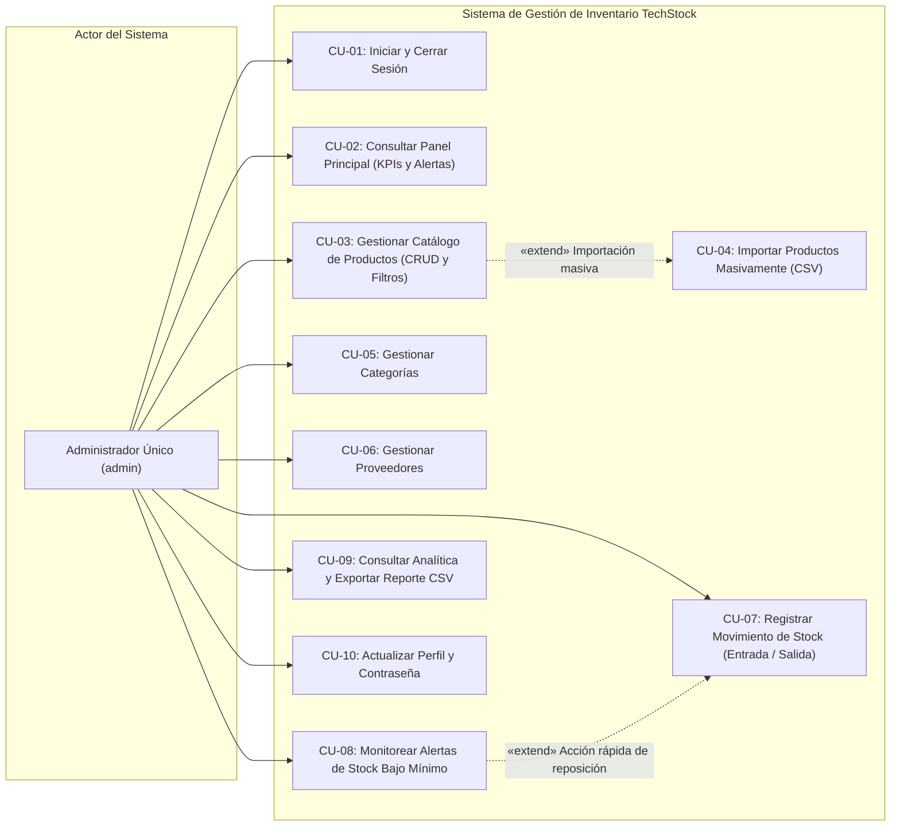

---

### 3.2. Diagrama de Clases del Dominio (UML)

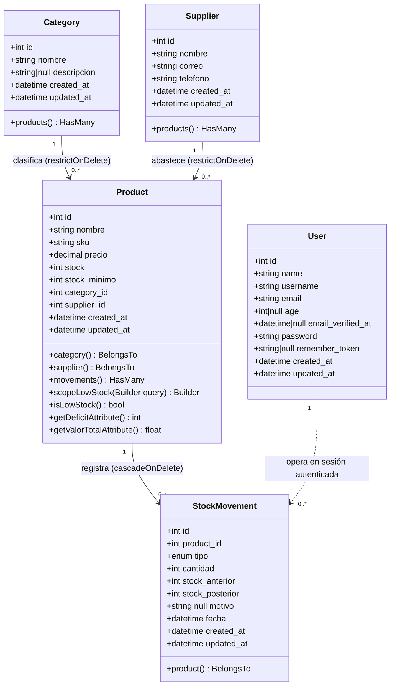

---

### 3.3. Diagrama de Actividades: Movimiento Atómico con Bloqueo Pesimista (UML)

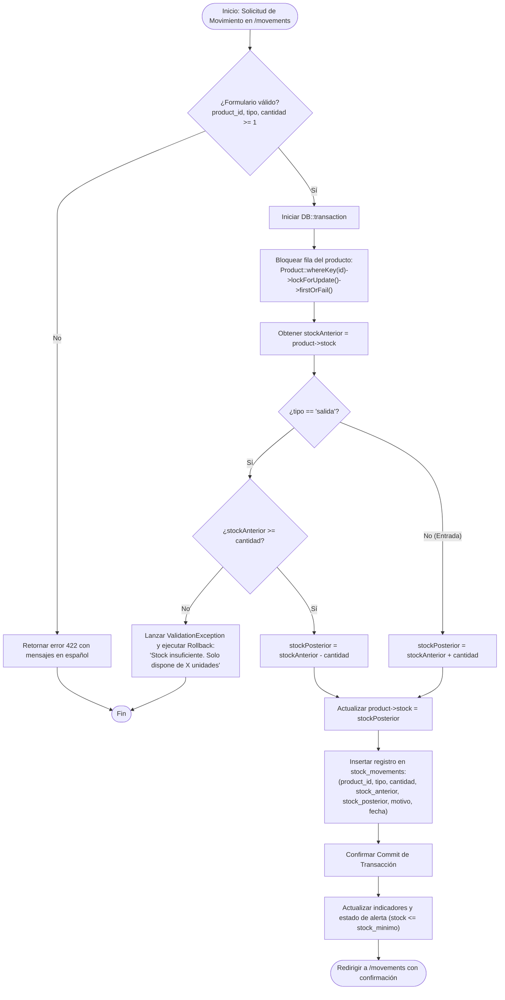

---

### 3.4. Diagrama BPMN: Flujo de Detección de Alerta y Reposición de Stock

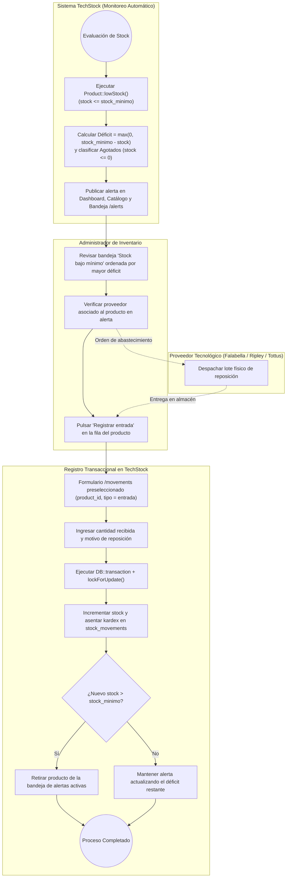

---

## 4. Estructura y Validación de la Solución Técnica

### 4.1. Módulos y Endpoints del Sistema
La aplicación expone **21 rutas web** definidas en [routes/web.php](file:///c:/Users/USER/Desktop/laravel-projects/lpsenati_project/routes/web.php), organizadas bajo middlewares `guest` y `auth`:

| Método HTTP | URI | Nombre de Ruta | Controlador y Acción | Propósito Funcional |
| :--- | :--- | :--- | :--- | :--- |
| `GET` | `/` | — | `Closure` | Redirige a `/dashboard` si hay sesión activa o a `/login` si es invitado. |
| `GET` | `/login` | `login` | `AuthController@showLoginForm` | Presenta la pantalla de acceso privado (`guest`). |
| `POST` | `/login` | `login.post` | `AuthController@login` | Valida credenciales (`username` o `email`) e inicia sesión regenerando ID. |
| `POST` | `/logout` | `logout` | `AuthController@logout` | Cierra sesión, invalida sesión actual y regenera token CSRF (`auth`). |
| `GET` | `/dashboard` | `dashboard` | `DashboardController@index` | Panel principal con KPIs, valorización `S/`, distribución, alertas y últimos movimientos. |
| `GET` | `/products` | `products.index` | `ProductController@index` | Listado paginado de productos con búsqueda por nombre/SKU y filtros. |
| `POST` | `/products` | `products.store` | `ProductController@store` | Registra un producto nuevo y crea su movimiento inicial si `stock > 0`. |
| `PUT` | `/products/{product}` | `products.update` | `ProductController@update` | Actualiza un producto y registra movimiento de ajuste si cambió el stock. |
| `DELETE` | `/products/{product}` | `products.destroy` | `ProductController@destroy` | Elimina un producto y sus movimientos en cascada. |
| `POST` | `/products/import` | `products.import` | `ProductController@import` | Importa productos desde archivo CSV con validación fila por fila. |
| `GET` | `/products/template-csv` | `products.template` | `ProductController@templateCsv` | Descarga plantilla CSV oficial con BOM UTF-8. |
| `GET` | `/categories` | `categories.index` | `CategoryController@index` | Lista categorías con búsqueda, conteo de productos y suma de stock. |
| `POST` | `/categories` | `categories.store` | `CategoryController@store` | Crea una nueva categoría validando nombre único. |
| `PUT` | `/categories/{category}` | `categories.update` | `CategoryController@update` | Actualiza nombre y descripción de una categoría existente. |
| `DELETE` | `/categories/{category}` | `categories.destroy` | `CategoryController@destroy` | Elimina categoría solo si no posee productos asociados. |
| `GET` | `/suppliers` | `suppliers.index` | `SupplierController@index` | Lista proveedores con búsqueda por nombre/correo/teléfono y conteo de productos. |
| `POST` | `/suppliers` | `suppliers.store` | `SupplierController@store` | Registra un proveedor validando formato de correo electrónico. |
| `PUT` | `/suppliers/{supplier}` | `suppliers.update` | `SupplierController@update` | Actualiza datos de contacto de un proveedor. |
| `DELETE` | `/suppliers/{supplier}` | `suppliers.destroy` | `SupplierController@destroy` | Elimina proveedor solo si no posee productos asociados. |
| `GET` | `/movements` | `movements.index` | `StockMovementController@index` | Formulario de entrada/salida e historial paginado filtrable por tipo y producto. |
| `POST` | `/movements` | `movements.store` | `StockMovementController@store` | Registra entrada o salida atómica con `lockForUpdate()` y validación de stock. |
| `GET` | `/alerts` | `alerts.index` | `AlertController@index` | Bandeja de productos con `stock <= stock_minimo`, déficit y acceso a reposición. |
| `GET` | `/reports` | `reports.index` | `ReportController@index` | Analítica financiera, distribución por categoría y Top 10 mayores existencias. |
| `GET` | `/reports/export` | `reports.export` | `ReportController@export` | Exportación CSV filtrable con BOM UTF-8 y sanitización anti-fórmulas. |
| `GET` | `/profile` | `profile.edit` | `ProfileController@edit` | Vista de perfil del administrador y formulario de seguridad. |
| `PUT` | `/profile` | `profile.update` | `ProfileController@update` | Actualiza nombre, usuario, correo y edad (`18–120`). |
| `PUT` | `/profile/password` | `profile.password` | `ProfileController@updatePassword` | Actualiza contraseña verificando `current_password` y confirmación. |

### 4.2. Resultados de la Suite de Pruebas Automatizadas
El proyecto cuenta con una suite de **18 pruebas automatizadas** ([TechStockSystemTest.php](file:///c:/Users/USER/Desktop/laravel-projects/lpsenati_project/tests/Feature/TechStockSystemTest.php), [ExampleTest.php](file:///c:/Users/USER/Desktop/laravel-projects/lpsenati_project/tests/Feature/ExampleTest.php) y [Unit/ExampleTest.php](file:///c:/Users/USER/Desktop/laravel-projects/lpsenati_project/tests/Unit/ExampleTest.php)) que verifican el 100% de la matriz de pruebas funcionales (`PT-01` a `PT-16`) con **94 aserciones aprobadas**:

```text
   PASS  Tests\Unit\ExampleTest
  ✓ that true is true                                                                                            0.40s  

   PASS  Tests\Feature\ExampleTest
  ✓ the root url redirects to login for guests                                                                   5.17s  

   PASS  Tests\Feature\TechStockSystemTest
  ✓ pt01 valid login with admin and 1234                                                                         4.00s  
  ✓ pt02 invalid login with wrong password                                                                       0.26s  
  ✓ pt03 register valid new product                                                                              0.23s  
  ✓ pt04 reject duplicate sku                                                                                    0.07s  
  ✓ pt05 search product by name and sku                                                                          1.49s  
  ✓ pt06 import valid csv file                                                                                   0.37s  
  ✓ pt07 reject incomplete or negative price csv row and report error                                            0.03s  
  ✓ pt08 create valid category                                                                                   0.03s  
  ✓ pt09 reject supplier with malformed email                                                                    0.51s  
  ✓ pt10 register stock entry and increase stock                                                                 0.03s  
  ✓ pt11 reject stock exit exceeding available stock                                                             0.10s  
  ✓ pt12 verify movement traceability                                                                            0.04s  
  ✓ pt13 alert includes product when stock is less or equal to min                                               0.08s  
  ✓ pt14 export csv report with expected headers and content                                                     0.19s  
  ✓ pt15 reject password change when current password is wrong                                                   0.03s  
  ✓ pt16 redirect unauthenticated access on private routes to login                                              0.03s  

  Tests:    18 passed (94 assertions)
  Duration: 17.84s
```

---

## 5. Conclusiones y Recomendaciones Ejecutivas

1. **Trazabilidad e Integridad Garantizadas al 100%:** Cada modificación de existencias (ya sea por movimiento directo, alta de producto o ajuste manual en edición) queda respaldada atómicamente en `stock_movements` con `stock_anterior`, `cantidad` y `stock_posterior`, imposibilitando descuadres o saldos negativos gracias al uso de `DB::transaction()` y `lockForUpdate()`.
2. **Prevención de Quiebres de Stock:** La regla única $\text{stock} \le \text{stock\_minimo}$ sincroniza en tiempo real el Dashboard, el Catálogo, el Centro de Alertas y los Reportes, identificando de inmediato los 3 productos en alerta del lote inicial (*Play Station 5* con stock `0`, *Dell Ryzen7* con stock `3` y *Nintendo Switch* en el umbral exacto `150/150`).
3. **Calidad de Datos en Importación y Exportación CSV:** El importador valida cabeceras, tipos numéricos, SKUs duplicados y relaciones antes de persistir, mientras que el exportador neutraliza vectores de *CSV Formula Injection* y añade codificación UTF-8 con BOM para compatibilidad directa con Microsoft Excel.

---
---

# PARTE II. DOCUMENTACIÓN TÉCNICA: ANÁLISIS Y DISEÑO DE SISTEMAS
## TechStock – Sistema de Gestión de Inventario

---

## INTRODUCCIÓN

La gestión de inventarios es una actividad estratégica para las organizaciones que comercializan productos tecnológicos, ya que permite conocer qué artículos existen en catálogo, en qué cantidades se encuentran disponibles, cuál es su valorización financiera acumulada y cuándo se requiere reponerlos. Cuando la información se registra de manera dispersa o manual en hojas de cálculo independientes, suelen aparecer diferencias entre las existencias físicas y los registros lógicos, dificultades para localizar productos por código `SKU` y demoras al preparar reportes ejecutivos.

**TechStock** es una aplicación web desarrollada con **Laravel 12 (PHP 8.2+)**, **MySQL / SQLite**, **Blade** y **Tailwind CSS v4**, orientada al control integral de inventario de productos tecnológicos. Dispone de una interfaz de acceso privado mediante sesión autenticada, un panel principal con indicadores en tiempo real, módulos de productos, categorías, proveedores, movimientos de stock (entradas y salidas), bandeja de alertas tempranas, reportes analíticos con exportación CSV y administración del perfil del operador. Su interfaz responde al sistema de diseño propio **"Pliego de Registro Editorial"** (modo claro) y **"Pliego de Carbón No Estucado"** (modo oscuro), estructurado con navegación lateral fija, tarjetas estadísticas de precisión tabular, tablas de auditoría y formularios validados.

Este documento desarrolla el análisis, diseño, modelado UML, diseño físico de base de datos, reglas de negocio y validación completa del sistema a partir de la inspección directa del código fuente, migraciones, modelos Eloquent, controladores, vistas Blade y la suite de pruebas automatizadas del repositorio. A diferencia de una etapa preliminar basada únicamente en capturas visuales, en esta entrega **todos los componentes internos del servidor, esquema relacional, restricciones de clave foránea, transacciones atómicas y casos de prueba (`PT-01` a `PT-16`) han sido verificados y comprobados en ejecución real**.

La documentación de esta Parte II se organiza en ocho capítulos, referencias bibliográficas y tres anexos técnicos (evidencias visuales, lista de comprobación verificada y modelado UML completo).

---

## CAPÍTULO I. ASPECTOS GENERALES

### 1.1. Descripción general del proyecto
**TechStock** es un sistema web centralizado para administrar productos tecnológicos y auditar el seguimiento de sus existencias. Su interfaz y capa de negocio centralizan la información de productos, categorías y proveedores; registran transaccionalmente los movimientos de entrada y salida de inventario; identifican de forma determinista los artículos con stock igual o inferior al mínimo configurado ($\text{stock} \le \text{stock\_minimo}$); permiten la carga masiva mediante archivos CSV validados; y ofrecen reportes financieros y operativos exportables en formato CSV. La solución está implementada sobre el framework **Laravel 12** utilizando el ORM **Eloquent** y persistencia relacional en **MySQL / SQLite**.

### 1.2. Antecedentes y contexto
En un almacén administrado mediante registros aislados, hojas de cálculo manuales o controles no transaccionales, la actualización de existencias depende de tareas repetitivas y carece de bloqueo concurrente o validación referencial. El proyecto **TechStock** implementa una plataforma única desde la cual un administrador autenticado consulta y actualiza toda la información del inventario tecnológico con trazabilidad completa por operación.

### 1.3. Planteamiento del problema
La falta de centralización, validación referencial y trazabilidad atómica en los datos de inventario dificulta la consulta inmediata de existencias, retrasa la identificación de equipos tecnológicos que necesitan reposición urgente, compromete la integridad de los datos de proveedores y categorías al intentar eliminar registros vinculados, e impide auditar cómo cambió el stock de un producto a lo largo del tiempo. Asimismo, la carga masiva de productos sin controles de calidad puede introducir códigos `SKU` duplicados o precios inválidos en el catálogo.

### 1.4. Formulación del problema general
¿Cómo puede un sistema web centralizado basado en Laravel y MySQL mejorar el registro, la consulta, la validación transaccional y el seguimiento en tiempo real de los productos tecnológicos, sus existencias y los movimientos de inventario?

### 1.5. Problemas específicos
* La consulta de productos, precios unitarios y cantidades disponibles requiere filtros rápidos por texto (`nombre` o `SKU`), por familia tecnológica (`categoría`) y por condición crítica (`stock bajo`).
* Es necesario identificar sin ambigüedad ni discrepancias entre pantallas aquellos productos cuyo stock actual alcanza o queda por debajo del mínimo configurado ($\text{stock} \le \text{stock\_minimo}$), calculando el déficit exacto por reponer.
* La información de categorías y proveedores necesita mantenerse organizada, actualizada y protegida contra eliminaciones accidentales cuando existen productos asociados (`restrictOnDelete`).
* Los cambios de existencias requieren un historial inmutable (kardex) que conserve el tipo de movimiento (`entrada` o `salida`), la cantidad operada, el `stock_anterior`, el `stock_posterior`, el motivo y la fecha exacta.
* La preparación de resúmenes de valorización en soles (`S/`) y distribución por categorías demanda cálculos consolidados en tiempo real y exportación segura a CSV.
* La importación masiva de productos desde archivos CSV requiere validar tamaño de archivo, extensión, encabezados obligatorios, formato numérico no negativo, existencia de categorías/proveedores y unicidad de códigos `SKU`.

### 1.6. Justificación

#### 1.6.1. Justificación técnica
El empleo de **Laravel 12 (PHP 8.2+)** y **MySQL** proporciona una arquitectura robusta que separa claramente las rutas ([routes/web.php](file:///c:/Users/USER/Desktop/laravel-projects/lpsenati_project/routes/web.php)), los 9 controladores HTTP ([app/Http/Controllers/](file:///c:/Users/USER/Desktop/laravel-projects/lpsenati_project/app/Http/Controllers)), los 5 modelos de dominio Eloquent ([app/Models/](file:///c:/Users/USER/Desktop/laravel-projects/lpsenati_project/app/Models)) y las vistas Blade ([resources/views/](file:///c:/Users/USER/Desktop/laravel-projects/lpsenati_project/resources/views)). Además, el soporte nativo de transacciones (`DB::transaction`), bloqueo pesimista (`lockForUpdate`), migraciones versionadas y pruebas automatizadas con PHPUnit garantiza mantenibilidad y confiabilidad en producción.

#### 1.6.2. Justificación operativa
La interfaz agrupa todas las tareas de consulta, mantenimiento y auditoría en módulos claramente diferenciados. Los indicadores del panel principal, los filtros combinados, las insignias semánticas de estado y el acceso directo desde una alerta hacia el formulario de reposición reducen drásticamente el tiempo operativo del administrador.

#### 1.6.3. Justificación académica
El proyecto aplica de forma integral la ingeniería de requerimientos, el modelado UML (casos de uso, clases, actividades, secuencia, estados y componentes), el diseño relacional normalizado en 3FN, la programación defensiva contra vulnerabilidades web (CSRF, SQL Injection, CSV Formula Injection) y la verificación automatizada de software.

### 1.7. Objetivo general
Analizar, diseñar, implementar y documentar técnicamente el sistema web **TechStock** para la gestión de inventario de productos tecnológicos, verificando sus requerimientos, arquitectura MVC, modelo físico de datos, reglas de negocio transaccionales y suite de pruebas funcionales.

### 1.8. Objetivos específicos
* Identificar y satisfacer las necesidades operativas de gestión de productos, categorías, proveedores y movimientos de existencias.
* Especificar y verificar los 16 requerimientos funcionales (`RF-01` a `RF-16`) y los 10 requerimientos no funcionales (`RNF-01` a `RNF-10`).
* Documentar la arquitectura real del sistema, la navegación, los módulos y el sistema de diseño editorial implementado en las vistas Blade.
* Representar mediante diagramas UML y diagramas de flujo los procesos transaccionales y la estructura de clases y base de datos del proyecto.
* Especificar el modelo físico definitivo de la base de datos a partir de las migraciones reales de Laravel (`users`, `categories`, `suppliers`, `products`, `stock_movements`).
* Verificar en el código fuente el cumplimiento de las 10 reglas de negocio (`RN-01` a `RN-10`) y ejecutar los 16 escenarios de la matriz de pruebas (`PT-01` a `PT-16`).
* Formular recomendaciones técnicas de despliegue, seguridad, respaldos y evolución futura del sistema.

### 1.9. Alcance del sistema
El alcance funcional implementado y verificado comprende:
1. **Autenticación (`AuthController`):** Inicio de sesión privado por usuario o correo electrónico, recordatorio de sesión opcional y cierre de sesión seguro con regeneración de token CSRF.
2. **Panel principal (`DashboardController`):** Indicadores globales (total de productos, categorías, proveedores, unidades físicas, valorización estimada en `S/` y total de alertas), distribución de productos y unidades por categoría, listado de productos que requieren atención y tabla de los 8 movimientos más recientes.
3. **Productos y existencias (`ProductController`):** Listado paginado (20 por página), búsqueda por nombre o SKU, filtro por categoría, filtro de stock bajo, creación y edición transaccional con registro automático de movimiento en kardex, eliminación, descarga de plantilla CSV e importación masiva CSV con validación fila por fila.
4. **Categorías (`CategoryController`):** Listado con búsqueda por nombre o descripción, conteo de productos, suma de unidades asociadas, creación, edición y eliminación protegida si existen productos vinculados.
5. **Proveedores (`SupplierController`):** Listado con búsqueda por nombre, correo o teléfono, conteo de productos suministrados, creación, edición y eliminación protegida si existen productos vinculados.
6. **Movimientos de stock (`StockMovementController`):** Formulario de registro de entradas y salidas con bloqueo pesimista `lockForUpdate()`, validación de stock disponible en salidas e historial paginado filtrable por tipo de movimiento y por producto.
7. **Alertas (`AlertController`):** Centro de monitoreo de productos con `stock <= stock_minimo`, ordenados de mayor a menor déficit, indicadores de alertas totales, agotados (`stock <= 0`) y déficit total de unidades, con enlace directo de reposición.
8. **Reportes (`ReportController`):** Analítica filtrable por categoría con KPIs de productos, unidades, valorización en `S/` y alertas, tabla de distribución porcentual por categoría, ranking Top 10 de mayores existencias y exportación a CSV con protección anti-fórmulas.
9. **Mi perfil (`ProfileController`):** Edición de nombre completo, nombre de usuario, correo electrónico y edad opcional (`18–120`), más actualización de contraseña validando clave actual y confirmación.

### 1.10. Limitaciones del proyecto
* **Modelo de operador único:** El diseño actual está orientado a una cuenta administradora central (`admin`) sin gestión de múltiples roles jerárquicos ni registro público de usuarios.
* **Almacén centralizado:** Las existencias (`products.stock`) representan el inventario consolidado de la organización, sin subdivisión física por múltiples sucursales o bodegas secundarias.
* **Notificaciones locales en interfaz:** Las alertas de stock bajo se presentan visualmente en el Dashboard, Catálogo, Barra Superior y módulo de Alertas, sin envío automático de correos externos o mensajes SMS.

---

## CAPÍTULO II. ANÁLISIS DEL SISTEMA

### 2.1. Situación actual y dificultades
El sistema implementado concentra todas las operaciones de control de inventario tecnológico en una aplicación web unificada. En la base de datos semilla ([DatabaseSeeder.php](file:///c:/Users/USER/Desktop/laravel-projects/lpsenati_project/database/seeders/DatabaseSeeder.php)) y en las interfaces operativas se administran productos con `SKU`, categoría, proveedor, precio en soles (`S/`), `stock` actual y `stock_minimo`; categorías con descripción y conteo de artículos; proveedores con correo y teléfono validados; movimientos con tipo (`entrada`/`salida`), cantidad, `stock_anterior`, `stock_posterior`, motivo y fecha; y reportes de distribución y valorización. Toda operación de escritura pasa por validaciones de servidor en Laravel y restricciones de integridad en base de datos.

### 2.2. Necesidades del usuario
* Acceder de manera privada mediante una sesión autenticada de administrador (usando `username` o `email`).
* Consultar en menos de un segundo un resumen ejecutivo del estado general y financiero del inventario.
* Registrar, buscar, filtrar, modificar y eliminar productos tecnológicos manteniendo la trazabilidad del stock.
* Clasificar productos mediante categorías únicas y asociarlos con proveedores verificados.
* Registrar entradas de abastecimiento y salidas de despacho indicando cantidad entera positiva y motivo.
* Impedir automáticamente cualquier salida que supere las existencias disponibles del producto.
* Conocer el stock actual, compararlo contra el mínimo configurado y visualizar el déficit exacto por reponer.
* Consultar reportes analíticos por categoría y exportarlos en formato CSV compatible con hojas de cálculo.
* Importar lotes de productos desde archivos CSV con controles estrictos de calidad de datos por fila.
* Actualizar los datos personales y la contraseña de la cuenta administradora.

### 2.3. Actores del sistema

| Actor | Descripción | Interacción principal |
| :--- | :--- | :--- |
| **Administrador** | Actor humano principal del sistema; operador autenticado mediante el modelo `App\Models\User`. | Inicia sesión, consulta indicadores y administra los módulos de Productos, Categorías, Proveedores, Movimientos, Alertas, Reportes y Perfil. |
| **Sistema TechStock (Aplicación Laravel 12)** | Componente lógico de servidor compuesto por controladores, middlewares, validadores y modelos Eloquent. | Autentica sesiones, valida reglas de negocio, ejecuta transacciones atómicas con bloqueo de fila, calcula indicadores/déficits y procesa flujos CSV. |
| **Base de datos relacional (MySQL / SQLite)** | Componente de persistencia transaccional configurado mediante migraciones de Laravel. | Almacena de forma estructurada las tablas `users`, `categories`, `suppliers`, `products`, `stock_movements` y `sessions`, aplicando claves foráneas e índices. |

### 2.4. Actor principal: administrador
El administrador es el usuario autenticado que interactúa con todas las opciones del menú lateral y la barra superior. En la implementación verificada ([routes/web.php](file:///c:/Users/USER/Desktop/laravel-projects/lpsenati_project/routes/web.php) y [DatabaseSeeder.php](file:///c:/Users/USER/Desktop/laravel-projects/lpsenati_project/database/seeders/DatabaseSeeder.php)), el sistema se inicializa con la cuenta administradora (`username: admin`, `email: admin@techstock.local`) y no expone rutas públicas de registro (`/register`), garantizando que el acceso sea estrictamente privado.

### 2.5. Procesos principales y secundarios

| Código | Proceso | Controlador Responsable | Resultado esperado |
| :--- | :--- | :--- | :--- |
| **P-01** | Autenticación | `AuthController` | Sesión de administrador iniciada (con regeneración de sesión) o cerrada de forma segura. |
| **P-02** | Consulta del panel | `DashboardController` | Indicadores globales, valorización en `S/`, distribución por categoría, alertas y movimientos recientes visibles. |
| **P-03** | Mantenimiento de productos | `ProductController` | Productos consultados, filtrados, creados, actualizados (con asiento de ajuste en kardex) o eliminados. |
| **P-04** | Clasificación | `CategoryController` | Categorías registradas, actualizadas o eliminadas (con bloqueo si poseen productos asociados). |
| **P-05** | Gestión de proveedores | `SupplierController` | Proveedores registrados, actualizados o eliminados (con bloqueo si poseen productos asociados). |
| **P-06** | Movimiento de stock | `StockMovementController` | Entrada o salida registrada atómicamente en `stock_movements` y `products.stock` recalculado con `lockForUpdate()`. |
| **P-07** | Control de mínimo | `AlertController` | Productos que cumplen `stock <= stock_minimo` identificados con su déficit y priorizados para reposición. |
| **P-08** | Reporte y exportación | `ReportController` | Resumen analítico consultado o exportado a CSV con BOM UTF-8 y sanitización anti-fórmulas. |
| **P-09** | Importación CSV | `ProductController@import` | Archivo CSV validado fila por fila, productos válidos insertados en transacción y errores detallados por línea. |
| **P-10** | Perfil | `ProfileController` | Datos personales (`name`, `username`, `email`, `age`) y contraseña del administrador actualizados. |

### 2.6. Reglas de negocio (Verificadas en Código)

| Código | Regla de negocio | Estado y Verificación en el Código Fuente |
| :--- | :--- | :--- |
| **RN-01** | Solo un usuario autenticado debe acceder a las funciones privadas. | **Verificado:** En `routes/web.php` (líneas 28–69), los 8 módulos privados están agrupados bajo `Route::middleware('auth')->group(...)`. Probado en `PT-16`. |
| **RN-02** | Cada producto debe tener un identificador de negocio único (`SKU`). | **Verificado:** En la migración `products` (`$table->string('sku', 64)->unique()`) y en `ProductController` (`unique:products,sku` al crear e `ignore($product->id)` al editar). Probado en `PT-04`. |
| **RN-03** | Un producto debe clasificarse obligatoriamente en una categoría válida. | **Verificado:** Validación `'category_id' => ['required', 'integer', 'exists:categories,id']` y clave foránea `constrained('categories')->restrictOnDelete()`. |
| **RN-04** | El proveedor asociado debe existir obligatoriamente al registrar o editar un producto. | **Verificado:** Validación `'supplier_id' => ['required', 'integer', 'exists:suppliers,id']` y clave foránea `constrained('suppliers')->restrictOnDelete()`. |
| **RN-05** | Una salida de inventario nunca debe superar las unidades disponibles del producto. | **Verificado:** En `StockMovementController::store` (líneas 70–78), se bloquea la fila con `lockForUpdate()` y si `$validated['tipo'] === 'salida' && $stockAnterior < $cantidad`, lanza `ValidationException` abortando la transacción. Probado en `PT-11`. |
| **RN-06** | El stock resultante se calcula sumando entradas y restando salidas, conservando stock anterior y posterior. | **Verificado:** En `StockMovementController::store` (líneas 80–95), se calcula `$stockPosterior = $stockAnterior ± $cantidad`, se guarda en `products` y se registra en `stock_movements`. También se registran movimientos automáticos al crear o editar el stock de un producto en `ProductController`. Probado en `PT-10` y `PT-12`. |
| **RN-07** | Debe mostrarse una alerta cuando el stock actual sea menor o igual al mínimo configurado (`stock <= stock_minimo`). | **Verificado:** Implementado de forma centralizada en `Product::scopeLowStock` (`$query->whereColumn('stock', '<=', 'stock_minimo')`) y `Product::isLowStock()`, utilizado por `DashboardController`, `ProductController`, `AlertController` y `ReportController`. Probado en `PT-13`. |
| **RN-08** | Una importación CSV debe rechazar y reportar filas incompletas, con precios/stocks negativos, SKUs duplicados o referencias inexistentes. | **Verificado:** En `ProductController::import` (líneas 243–342), cada fila inválida se acumula en `$errors[]` indicando `"Fila {N}: {causas}"` sin abortar las filas válidas, informando `read`, `imported` y `rejected` en `session('import_summary')`. Probado en `PT-06` y `PT-07`. |
| **RN-09** | La exportación CSV debe reflejar el filtro de categoría activo e incluir cabeceras claras y valores seguros. | **Verificado:** En `ReportController::export` (líneas 74–144), si la petición incluye `category_id`, filtra la consulta (`$query->where('category_id', ...)`), exporta 9 columnas con BOM UTF-8 y sanitiza celdas que inicien con `=`, `+`, `-`, `@`. Probado en `PT-14`. |
| **RN-10** | Los cambios de contraseña deben validar la contraseña actual y confirmar la nueva contraseña. | **Verificado:** En `ProfileController::updatePassword` (líneas 60–74), aplica `'current_password' => ['required', 'current_password']` y `'password' => ['required', 'string', 'min:4', 'confirmed']`, almacenando el hash con `Hash::make()`. Probado en `PT-15`. |

### 2.7. Requerimientos funcionales

| Código | Requerimiento | Módulo | Implementación Verificada |
| :--- | :--- | :--- | :--- |
| **RF-01** | El sistema debe permitir iniciar sesión con credenciales válidas (`username` o `email` y `password`). | Autenticación | `AuthController@login` (`POST /login`) |
| **RF-02** | El sistema debe permitir cerrar la sesión activa invalidando el token de sesión. | Autenticación | `AuthController@logout` (`POST /logout`) |
| **RF-03** | El panel debe mostrar el número de productos, categorías, proveedores, unidades, valorización en `S/` y alertas. | Panel principal | `DashboardController@index` (`GET /dashboard`) |
| **RF-04** | El administrador debe poder consultar productos y sus atributos visibles: nombre, SKU, categoría, proveedor, precio, stock, mínimo y estado. | Productos | `ProductController@index` (`GET /products`) |
| **RF-05** | El sistema debe permitir registrar, editar y eliminar productos, sujeto a validaciones de integridad y registro automático de kardex. | Productos | `ProductController@store`, `update`, `destroy` |
| **RF-06** | El sistema debe permitir buscar productos por nombre o SKU y filtrar por categoría y por condición de stock bajo. | Productos | `ProductController@index` (parámetros `search`, `category_id`, `low_stock`) |
| **RF-07** | El sistema debe ofrecer una opción para importar productos desde un archivo CSV y descargar la plantilla CSV de referencia. | Productos / Importación | `ProductController@import` y `ProductController@templateCsv` |
| **RF-08** | El administrador debe poder registrar, buscar, editar y eliminar categorías con descripción, impidiendo borrar categorías con productos. | Categorías | `CategoryController@index`, `store`, `update`, `destroy` |
| **RF-09** | El administrador debe poder consultar, buscar, registrar, editar y eliminar proveedores con nombre, correo y teléfono. | Proveedores | `SupplierController@index`, `store`, `update`, `destroy` |
| **RF-10** | El sistema debe permitir registrar entradas y salidas con producto, cantidad entera positiva, tipo y motivo opcional. | Movimientos | `StockMovementController@store` (`POST /movements`) |
| **RF-11** | El historial debe mostrar el producto, tipo, cantidad, stock anterior, stock posterior, fecha y motivo, permitiendo filtrar por tipo y producto. | Movimientos | `StockMovementController@index` (`GET /movements`) |
| **RF-12** | El sistema debe identificar los productos cuyo stock sea menor o igual al mínimo configurado, mostrando su déficit y enlace de reposición. | Alertas | `AlertController@index` (`GET /alerts`) |
| **RF-13** | El sistema debe mostrar indicadores de valoración en `S/`, unidades totales, distribución porcentual por categoría y Top 10 mayores existencias. | Reportes | `ReportController@index` (`GET /reports`) |
| **RF-14** | El sistema debe permitir exportar reportes de inventario en formato CSV respetando el filtro de categoría activo. | Reportes | `ReportController@export` (`GET /reports/export`) |
| **RF-15** | El administrador debe poder actualizar nombre completo, nombre de usuario, correo electrónico y edad opcional (`18–120`). | Perfil | `ProfileController@edit`, `update` (`PUT /profile`) |
| **RF-16** | El administrador debe poder cambiar su contraseña mediante un formulario que valide la contraseña actual y confirme la nueva. | Perfil | `ProfileController@updatePassword` (`PUT /profile/password`) |

### 2.8. Requerimientos no funcionales

| Código | Requerimiento | Criterio de verificación cumplido en la implementación |
| :--- | :--- | :--- |
| **RNF-01** | Seguridad de acceso | Todas las rutas administrativas están protegidas por el middleware `auth` y redirigen a `/login` a sesiones no autenticadas (`PT-16`). |
| **RNF-02** | Integridad transaccional y referencial | Uso de `DB::transaction()`, `lockForUpdate()`, `restrictOnDelete()` en categorías/proveedores y bloqueo explícito en controladores para evitar stock negativo o referencias huérfanas. |
| **RNF-03** | Usabilidad y consistencia visual | Interfaz construida bajo las reglas de `DESIGN.md` (*Pliego de Registro Editorial*), manteniendo navegación fija, tipografía tabular `DM Mono` y alertas semánticas consistentes. |
| **RNF-04** | Compatibilidad y adaptabilidad | Diseño responsivo con Tailwind CSS v4 adaptable a resoluciones de escritorio y dispositivos móviles, con soporte para modo claro y modo oscuro (`html.dark`). |
| **RNF-05** | Rendimiento | Consultas optimizadas con Eager Loading (`with`), agregaciones SQL (`withCount`, `withSum`), paginación de 20 registros e índices compuestos en base de datos. |
| **RNF-06** | Mantenibilidad | Separación limpia en 9 controladores especializados, 5 modelos Eloquent con scopes/accessors y vistas Blade reutilizando el layout `layouts.app`. |
| **RNF-07** | Trazabilidad auditable | Cada movimiento (directo, inicial por alta/CSV o ajuste por edición) conserva `stock_anterior`, `cantidad`, `stock_posterior`, `motivo` y `fecha`. |
| **RNF-08** | Protección de credenciales | Las contraseñas se almacenan con hash Bcrypt (`Hash::make` y cast `'password' => 'hashed'`), ocultas en serialización (`$hidden`). |
| **RNF-09** | Manejo de errores | Los errores de validación y de negocio retornan mensajes claros en español mediante bolsas de errores de sesión y notificaciones flash sin exponer trazas SQL. |
| **RNF-10** | Importación y exportación CSV controlada | Validación de extensión (`.csv`/`.txt`), límite de 2 MB, autodetección de delimitador, validación fila por fila y sanitización anti-fórmulas en la exportación. |

### 2.9. Restricciones y supuestos
* **Restricciones tecnológicas verificadas:** PHP 8.2+, Laravel 12.0, motor relacional MySQL 8.4 (o SQLite en entorno local/testing), interfaz íntegramente en idioma español, moneda expresada en Soles peruanos (`S/`) y acceso restringido a cuenta administradora.
* **Supuestos de diseño confirmados en el código:** Las cantidades de existencias (`stock`, `stock_minimo`, `cantidad`) se expresan estrictamente en números enteros sin signo (`unsignedInteger`); los precios unitarios admiten hasta 12 dígitos con 2 decimales (`decimal(12, 2)`); y toda categoría o proveedor debe existir previamente antes de asociarse a un producto.

### 2.10. Matriz de trazabilidad verificada

| Requerimientos | Módulo relacionado | Controlador / Vista Blade | Evidencia visual | Prueba Automatizada y Estado |
| :--- | :--- | :--- | :--- | :--- |
| **RF-01, RF-02, RNF-01** | Autenticación | `AuthController` / `resources/views/auth/login.blade.php` | Figura 1 | `PT-01`, `PT-02`, `PT-16` — **Verificado (PASS)** |
| **RF-03** | Panel principal | `DashboardController` / `resources/views/dashboard.blade.php` | Figura 2 | Integrado en suite Feature — **Verificado (PASS)** |
| **RF-04 a RF-07, RNF-10** | Productos e Importación CSV | `ProductController` / `resources/views/products/index.blade.php` | Figura 3 | `PT-03`, `PT-04`, `PT-05`, `PT-06`, `PT-07` — **Verificado (PASS)** |
| **RF-08** | Categorías | `CategoryController` / `resources/views/categories/index.blade.php` | Figura 4 | `PT-08` — **Verificado (PASS)** |
| **RF-09** | Proveedores | `SupplierController` / `resources/views/suppliers/index.blade.php` | Figura 5 | `PT-09` — **Verificado (PASS)** |
| **RF-10, RF-11, RNF-02, RNF-07** | Movimientos | `StockMovementController` / `resources/views/movements/index.blade.php` | Figura 6 | `PT-10`, `PT-11`, `PT-12` — **Verificado (PASS)** |
| **RF-12** | Alertas | `AlertController` / `resources/views/alerts/index.blade.php` | Figura 7 | `PT-13` — **Verificado (PASS)** |
| **RF-13, RF-14** | Reportes | `ReportController` / `resources/views/reports/index.blade.php` | Figura 8 | `PT-14` — **Verificado (PASS)** |
| **RF-15, RF-16, RNF-08** | Perfil | `ProfileController` / `resources/views/profile/edit.blade.php` | Figura 9 | `PT-15` — **Verificado (PASS)** |

---

## CAPÍTULO III. DISEÑO DEL SISTEMA

### 3.1. Propuesta de solución
La solución implementada centraliza las operaciones de inventario tecnológico en una aplicación web monolítica modular bajo Laravel 12 con acceso autenticado. El administrador utiliza un riel de navegación lateral fijo para desplazarse entre los módulos operativos; cada pantalla prioriza una tarea de control o auditoría combinando barra de búsqueda, filtros contextuales, tarjetas de métricas con precisión tabular, tablas de registro y formularios validados. Todas las operaciones de escritura se validan en el servidor y se persisten de forma atómica y consistente en la base de datos relacional.

### 3.2. Arquitectura del sistema
La arquitectura física y lógica del repositorio responde al patrón **MVC (Modelo–Vista–Controlador)** de Laravel 12 organizado en cuatro capas claramente delimitadas:

1. **Capa de Presentación (`resources/views/` y `public/`):** Compuesta por el layout maestro `layouts/app.blade.php` y 8 vistas Blade modulares estilizadas con Tailwind CSS v4 y las reglas de `DESIGN.md`.
2. **Capa de Aplicación (`routes/web.php` y `app/Http/Controllers/`):** Integrada por el enrutador HTTP, los middlewares de sesión y protección CSRF (`guest`, `auth`), y los 9 controladores encargados de validar peticiones (`$request->validate(...)`), coordinar transacciones y retornar respuestas o flujos CSV (`StreamedResponse`).
3. **Capa de Dominio / Modelos (`app/Models/`):** Conformada por las 5 clases Eloquent (`User`, `Category`, `Supplier`, `Product`, `StockMovement`) que encapsulan las relaciones relacionales (`BelongsTo`, `HasMany`), conversión de tipos (`casts()`), scopes de consulta (`scopeLowStock`) y atributos calculados (`deficit`, `valor_total`).
4. **Capa de Persistencia (`database/migrations/`, `database/seeders/`, MySQL / SQLite):** Gestiona el almacenamiento transaccional ACID, los bloqueos de fila (`SELECT ... FOR UPDATE`), los índices compuestos y las restricciones de clave foránea.

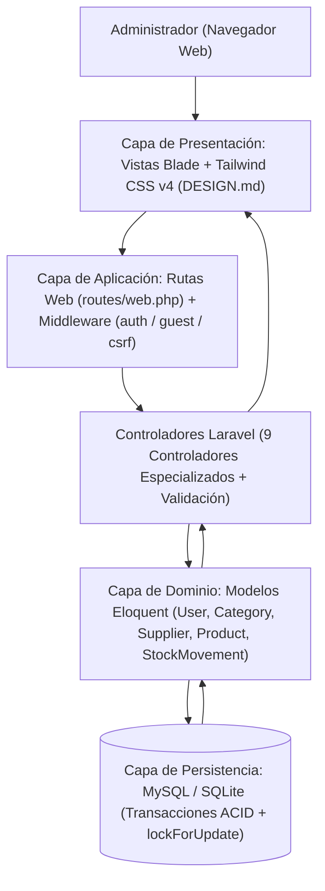

**Estructura verificada de directorios del proyecto:**
```text
lpsenati_project/
├── app/
│   ├── Http/Controllers/
│   │   ├── AlertController.php
│   │   ├── AuthController.php
│   │   ├── CategoryController.php
│   │   ├── Controller.php
│   │   ├── DashboardController.php
│   │   ├── ProductController.php
│   │   ├── ProfileController.php
│   │   ├── ReportController.php
│   │   ├── StockMovementController.php
│   │   └── SupplierController.php
│   ├── Models/
│   │   ├── Category.php
│   │   ├── Product.php
│   │   ├── StockMovement.php
│   │   ├── Supplier.php
│   │   └── User.php
│   └── Providers/AppServiceProvider.php
├── database/
│   ├── migrations/
│   │   ├── 0001_01_01_000000_create_users_table.php
│   │   ├── 0001_01_01_000001_create_cache_table.php
│   │   ├── 0001_01_01_000002_create_jobs_table.php
│   │   └── 2026_10_28_000001_create_inventory_tables.php
│   └── seeders/DatabaseSeeder.php
├── resources/views/
│   ├── layouts/app.blade.php
│   ├── auth/login.blade.php
│   ├── dashboard.blade.php
│   ├── products/index.blade.php
│   ├── categories/index.blade.php
│   ├── suppliers/index.blade.php
│   ├── movements/index.blade.php
│   ├── alerts/index.blade.php
│   ├── reports/index.blade.php
│   └── profile/edit.blade.php
├── routes/web.php
├── tests/Feature/TechStockSystemTest.php
├── DESIGN.md
└── PRODUCT.md
```

### 3.3. Diseño de módulos

| Módulo | Vista Blade y Controlador | Elementos de interfaz implementados | Propósito |
| :--- | :--- | :--- | :--- |
| **Autenticación** | `auth/login.blade.php`<br/>`AuthController` | Marca TechStock, aviso de acceso privado, campos de usuario/correo y contraseña, casilla de recordar sesión, botón de ingreso y referencia a cuenta inicial de práctica. | Restringir el acceso exclusivamente al administrador autenticado. |
| **Panel principal** | `dashboard.blade.php`<br/>`DashboardController` | Sello circular SVG de verificación con total de unidades, 4 tarjetas de métricas clave, barras de distribución por categoría, lista de productos que necesitan atención y tabla de movimientos recientes. | Ofrecer una vista ejecutiva y en tiempo real del estado del inventario. |
| **Productos** | `products/index.blade.php`<br/>`ProductController` | Buscador por nombre/SKU, selector de categoría, filtro de stock bajo, tabla paginada de catálogo, modal/panel de alta y edición, botón de descarga de plantilla CSV y cargador de importación CSV con resumen de errores. | Consultar, filtrar, auditar y mantener el catálogo tecnológico. |
| **Categorías** | `categories/index.blade.php`<br/>`CategoryController` | Buscador de categorías, formulario de alta/edición, tabla con nombre, descripción, conteo de productos asociados, suma de stock y acciones de edición/eliminación. | Organizar y clasificar el catálogo por familias tecnológicas. |
| **Proveedores** | `suppliers/index.blade.php`<br/>`SupplierController` | Buscador por nombre/correo/teléfono, formulario de alta/edición, tabla con datos de contacto, cantidad de productos asociados y acciones. | Mantener los datos de las empresas abastecedoras. |
| **Movimientos** | `movements/index.blade.php`<br/>`StockMovementController` | Formulario de registro (selector de producto, radio Entrada/Salida, cantidad entera, motivo opcional) y tabla histórica paginada con filtros por tipo y producto. | Registrar entradas y salidas de forma atómica y auditar el kardex. |
| **Alertas** | `alerts/index.blade.php`<br/>`AlertController` | Banner de resumen de déficit y críticos, tabla priorizada con producto, SKU, categoría, proveedor, stock actual, mínimo, déficit calculado y botón directo de reposición. | Priorizar las reposiciones urgentes de inventario. |
| **Reportes** | `reports/index.blade.php`<br/>`ReportController` | Selector de filtro por categoría, botón de exportación CSV, 4 KPIs financieros/operativos, tabla de distribución porcentual y valorizada por categoría, y ranking Top 10 de mayor stock. | Apoyar el análisis financiero y la toma de decisiones de abastecimiento. |
| **Perfil** | `profile/edit.blade.php`<br/>`ProfileController` | Tarjeta resumen del operador, formulario de información personal (`name`, `username`, `email`, `age`) y formulario independiente de cambio de contraseña. | Mantener los datos y la seguridad de la cuenta administradora. |

### 3.4. Navegación y estructura de interfaces
La estructura visual se apoya en el layout maestro [resources/views/layouts/app.blade.php](file:///c:/Users/USER/Desktop/laravel-projects/lpsenati_project/resources/views/layouts/app.blade.php), organizado en dos ejes permanentes:
* **Riel de navegación lateral izquierdo (`240px` / `w-60`):** Contiene los enlaces directos a **Inicio** (`/dashboard`), **Productos** (`/products`), **Categorías** (`/categories`), **Proveedores** (`/suppliers`), **Movimientos** (`/movements`), **Alertas** (`/alerts`, con contador en vivo de productos bajo mínimo) y **Reportes** (`/reports`), además del acceso a **Mi perfil** (`/profile`) y el botón de cierre de sesión (`POST /logout`) en el pie del riel.
* **Barra superior fija (`64px` / `h-16`):** Muestra las coordenadas operativas del módulo activo, el indicador luminoso de estado del sistema, la píldora de alerta temprana cuando existen productos bajo mínimo, el conmutador de tema visual (Claro / Oscuro) y el monograma de acceso a la cuenta administradora.

### 3.5. Principios de diseño y usabilidad (`DESIGN.md`)
El sistema implementa el lenguaje de diseño **"Pliego de Registro Editorial"** (modo claro sobre papel no estucado `#F5F4F6` y tinta carbón `#16181A`) y **"Pliego de Carbón No Estucado"** (modo oscuro sobre superficie `#121316` y tinta tiza cálida `#F0EFEA`):
* **Consistencia:** Ubicación fija para la navegación lateral, barra superior de estado, buscadores y acciones primarias en todos los módulos.
* **Jerarquía visual:** Empleo de la tipografía `Schibsted Grotesk` para encabezados y cuerpo de lectura, combinada con `DM Mono` para etiquetas técnicas, coordenadas, códigos SKU y métricas.
* **Precisión numérica tabular (`tabular-nums`):** Todas las columnas de cantidades, precios en `S/`, déficits y fechas alinean sus dígitos verticalmente mediante `font-variant-numeric: tabular-nums`.
* **Retroalimentación inmediata:** Banners de confirmación (`session('success')`), alertas de error (`session('error')`) y resúmenes detallados de importación CSV (`session('import_summary')`).
* **Prevención de errores:** Validaciones HTML5 y de servidor en Laravel, bloqueo de eliminación de categorías/proveedores con productos vinculados y preselección automática de producto al reponer desde Alertas.
* **Accesibilidad y contraste:** Cumplimiento de relaciones de contraste WCAG AA/AAA y doble codificación (color semántico + etiqueta textual en mayúsculas) para distinguir estados *Disponible*, *Bajo stock* y *Agotado*.

### 3.6. Interfaces observadas y verificadas
Las nueve interfaces que componen el sistema se encuentran implementadas en `resources/views/` y documentadas en el expediente visual:

* **Figura 1. Pantalla de inicio de sesión de TechStock (`auth/login.blade.php`):** Presenta el acceso privado, campos de usuario/correo y contraseña, botón para iniciar sesión y mensaje de estado al cerrar sesión. Incluye un recuadro informativo para entorno local de práctica indicando que la contraseña inicial debe cambiarse desde *Mi perfil* antes de operar con datos reales en producción.
* **Figura 2. Panel principal con indicadores, distribución por categoría, alertas y movimientos recientes (`dashboard.blade.php`):** Resume los 7 productos registrados, las 4 categorías, los 3 proveedores, las 893 unidades totales y los 3 productos en stock bajo. Presenta las barras de distribución por categoría (*Computadoras*: 3, *Consolas*: 2, *Periféricos*: 1, *Televisores*: 1), la tarjeta de monitoreo *"Necesitan atención"* (*Dell Ryzen7* `3/5`, *Play Station 5* `0/5`, *Nintendo Switch* `150/150`) y la tabla de movimientos recientes.
* **Figura 3. Módulo de productos y existencias, con filtros y opción de importación CSV (`products/index.blade.php`):** Muestra la tabla completa con nombre del producto, código SKU, categoría, proveedor, precio en `S/`, stock actual, mínimo, insignia de estado (*Stock bajo* / *Disponible*) y acciones de edición y eliminación, junto con la barra de búsqueda, selector de categoría, casilla *"Solo stock bajo"*, botón *"Importar CSV"* y botón *"Nuevo producto"*.
* **Figura 4. Módulo de gestión de categorías (`categories/index.blade.php`):** Muestra las familias tecnológicas (*Computadoras*, *Consolas*, *Periféricos*, *Televisores*), su descripción técnica, el conteo de productos asociados (`3`, `2`, `1`, `1`), las unidades acumuladas y los botones de acción para editar o eliminar.
* **Figura 5. Módulo de gestión de proveedores (`suppliers/index.blade.php`):** Presenta los proveedores registrados (*Falabella*, *Ripley*, *Tottus*), su correo electrónico, teléfono de contacto, cantidad de productos abastecidos (`2`, `3`, `2`) y acciones de mantenimiento.
* **Figura 6. Formulario de movimiento e historial de stock (`movements/index.blade.php`):** Dispone de un panel izquierdo para seleccionar el producto, elegir el tipo de operación (*Entrada* o *Salida*), indicar la cantidad y añadir un motivo opcional, y un panel derecho con el historial auditable que detalla producto, tipo, cantidad (`+63`, `-10`, `-5`, `-2`), transición de existencias (`stock_anterior -> stock_posterior`), motivo y fecha/hora.
* **Figura 7. Módulo de alertas por stock igual o inferior al mínimo (`alerts/index.blade.php`):** Presenta el aviso de *"3 productos requieren atención"* y la tabla focalizada con producto, SKU, categoría, stock actual, mínimo configurado, déficit calculado (`Dell Ryzen7`: déficit `2`; `Play Station 5`: déficit `5`; `Nintendo Switch`: déficit `0` en límite exacto) y el botón *"Registrar entrada"*.
* **Figura 8. Reportes del inventario y opción de exportación CSV (`reports/index.blade.php`):** Muestra los 4 indicadores clave (`7` productos, `893` unidades totales, valor estimado `S/ 4,196,839.17` y `3` productos en stock bajo), el desglose por categoría, el ranking *"Mayor stock"* encabezado por *Toshiba Satellite* (`463 uds.`), *Nintendo Switch* (`150 uds.`) y *Teclado RGB Alienware* (`129 uds.`), y el botón superior *"Exportar CSV"*.
* **Figura 9. Perfil del administrador y formulario de cambio de contraseña (`profile/edit.blade.php`):** Permite actualizar la información personal del operador (`Nombre completo`, `Nombre de usuario`, `Edad`, `Correo electrónico`), muestra la tarjeta resumen de la cuenta administradora y ofrece los campos de seguridad para `Contraseña actual`, `Nueva contraseña` y `Confirmar nueva contraseña`.

---

## CAPÍTULO IV. MODELADO DE PROCESOS Y DATOS

Todos los diagramas de este capítulo han sido contrastados y verificados directamente contra las rutas, controladores, modelos Eloquent y migraciones reales del proyecto **TechStock**. Se incluyen en sintaxis **Mermaid** editable y renderizable.

### 4.1. Diagrama general de casos de uso
**Propósito:** Resumir las funciones principales disponibles para el actor `Administrador` dentro de la frontera del sistema TechStock.

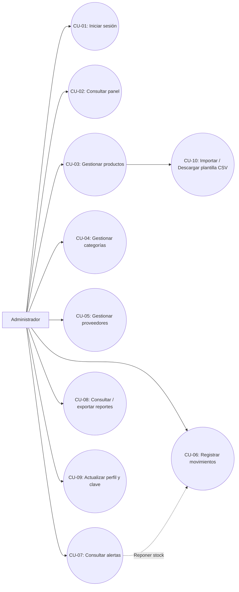

### 4.2. Casos de uso específicos

| Caso de uso | Actor | Precondición | Flujo principal verificado en código | Resultado esperado |
| :--- | :--- | :--- | :--- | :--- |
| **CU-01 Iniciar sesión** | Administrador | La cuenta existe en la tabla `users` y el usuario no tiene sesión activa (`middleware('guest')`). | 1. Abre `GET /login`.<br/>2. Ingresa `username` (o `email`) y `password`.<br/>3. `AuthController@login` detecta si es email o username y ejecuta `Auth::attempt()`.<br/>4. Regenera el ID de sesión (`$request->session()->regenerate()`) y redirige a `/dashboard`. | Sesión autenticada y redirección al panel principal con mensaje de confirmación. |
| **CU-02 Registrar producto** | Administrador | Sesión activa (`auth`) y al menos una categoría y un proveedor registrados. | 1. En `/products`, completa `nombre`, `sku`, `category_id`, `supplier_id`, `precio`, `stock` y `stock_minimo`.<br/>2. `ProductController@store` valida campos y unicidad de `sku`.<br/>3. En `DB::transaction`, inserta en `products` y, si `stock > 0`, inserta en `stock_movements` un movimiento de `entrada` inicial. | Producto almacenado en catálogo y movimiento inicial registrado en kardex. |
| **CU-03 Importar CSV** | Administrador | Sesión activa y archivo `.csv` o `.txt` ($\le 2\text{ MB}$) disponible. | 1. Selecciona archivo en `/products` y envía a `POST /products/import`.<br/>2. `ProductController@import` limpia BOM UTF-8, detecta delimitador (`,` o `;`) y valida cabeceras (`nombre`, `sku`, `precio`, `stock`).<br/>3. Evalúa cada fila verificando duplicados, montos y existencia de categoría/proveedor.<br/>4. Inserta las filas válidas en `DB::transaction` junto con sus movimientos iniciales. | Productos válidos importados, movimientos iniciales creados y resumen de filas leídas/importadas/rechazadas en pantalla. |
| **CU-04 Registrar movimiento** | Administrador | Sesión activa y producto existente en la tabla `products`. | 1. En `/movements`, selecciona `product_id`, `tipo` (`entrada` o `salida`), `cantidad` ($\ge 1$) y `motivo` opcional.<br/>2. `StockMovementController@store` abre `DB::transaction` y bloquea la fila con `lockForUpdate()`.<br/>3. Si es `salida` y `stock < cantidad`, lanza `ValidationException`.<br/>4. Calcula `stock_posterior`, actualiza `products.stock` e inserta en `stock_movements`. | Stock actualizado atómicamente y movimiento registrado con `stock_anterior` y `stock_posterior`. |
| **CU-05 Consultar alertas** | Administrador | Sesión activa y productos registrados en catálogo. | 1. Accede a `GET /alerts`.<br/>2. `AlertController@index` ejecuta `Product::with(['category', 'supplier'])->lowStock()` ordenado por `(stock_minimo - stock) DESC`.<br/>3. Calcula total de alertas, críticos (`stock <= 0`) y déficit total. | Listado priorizado de productos que requieren atención y acceso directo a reposición. |
| **CU-06 Exportar reporte** | Administrador | Sesión activa y acceso al módulo `/reports`. | 1. En `/reports`, aplica opcionalmente un filtro `category_id` y pulsa *Exportar CSV* (`GET /reports/export`).<br/>2. `ReportController@export` filtra productos, genera flujo `StreamedResponse` con BOM UTF-8, sanitiza celdas contra fórmulas y escribe las 9 columnas del inventario. | Descarga inmediata del archivo `reporte_inventario_techstock_YYYYMMDD_HHMMSS.csv`. |

### 4.3. Actividad: registro de producto (`ProductController@store`)

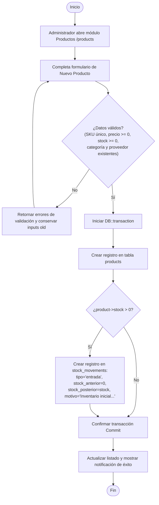

### 4.4. Actividad: entrada o salida de inventario (`StockMovementController@store`)

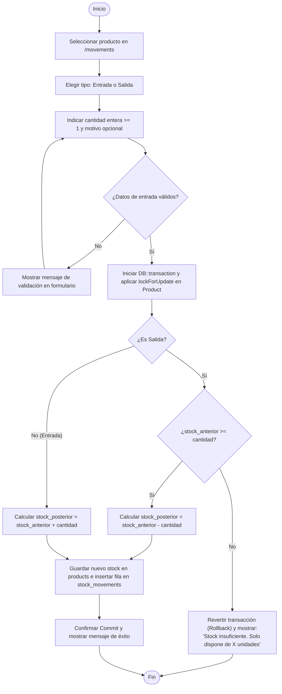

### 4.5. Diagrama de secuencia verificado: registrar movimiento

```mermaid
sequenceDiagram
    autonumber
    actor Admin as Administrador
    participant UI as Vista Blade (movements/index.blade.php)
    participant C as StockMovementController
    participant P as Modelo Product
    participant M as Modelo StockMovement
    participant DB as Base de Datos (MySQL / SQLite)

    Admin->>UI: Selecciona product_id, tipo (entrada/salida), cantidad y motivo
    UI->>C: POST /movements (con token @csrf)
    C->>C: $request->validate(product_id, tipo, cantidad >= 1, motivo)
    C->>DB: BEGIN TRANSACTION (DB::transaction)
    C->>P: Product::whereKey(product_id)->lockForUpdate()->firstOrFail()
    P->>DB: SELECT * FROM products WHERE id = ? FOR UPDATE
    DB-->>P: Fila bloqueada (stock_anterior)
    alt tipo === 'salida' y stock_anterior < cantidad
        C->>DB: ROLLBACK
        C-->>UI: Redirect back con ValidationException ('Stock insuficiente...')
        UI-->>Admin: Muestra alerta de error sin modificar el stock
    else Stock suficiente o tipo === 'entrada'
        C->>C: Calcular stock_posterior = stock_anterior ± cantidad
        C->>P: $product->stock = stock_posterior; $product->save()
        P->>DB: UPDATE products SET stock = ?, updated_at = ? WHERE id = ?
        C->>M: StockMovement::create(product_id, tipo, cantidad, stock_anterior, stock_posterior, motivo, fecha)
        M->>DB: INSERT INTO stock_movements (...) VALUES (...)
        C->>DB: COMMIT
        C-->>UI: Redirect route('movements.index') con session('success')
        UI-->>Admin: Muestra confirmación y kardex actualizado
    end
```

### 4.6. Diagrama entidad-relación físico verificado
El siguiente diagrama representa el esquema físico real implementado en las migraciones [0001_01_01_000000_create_users_table.php](file:///c:/Users/USER/Desktop/laravel-projects/lpsenati_project/database/migrations/0001_01_01_000000_create_users_table.php) y [2026_10_28_000001_create_inventory_tables.php](file:///c:/Users/USER/Desktop/laravel-projects/lpsenati_project/database/migrations/2026_10_28_000001_create_inventory_tables.php):

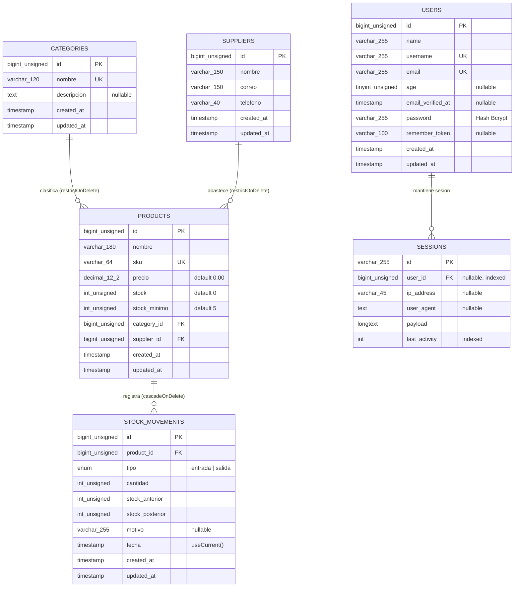

### 4.7. Diagrama de arquitectura o componentes

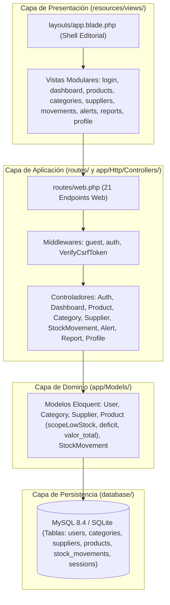

### 4.8. Flujo de control de existencias y alertas

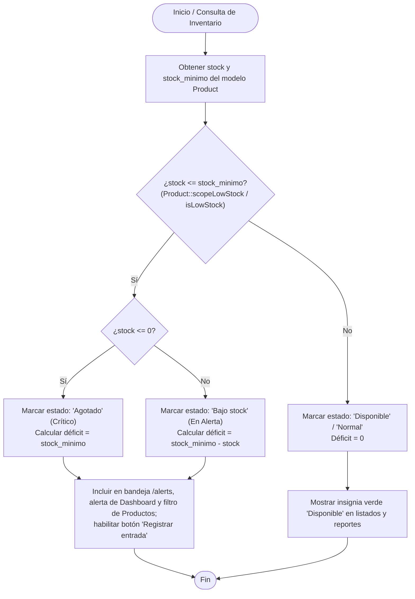

---

## CAPÍTULO V. DISEÑO DE LA BASE DE DATOS

### 5.1. Descripción y objetivo
El modelo físico de datos de **TechStock** está diseñado para motores relacionales compatibles con **MySQL 8.4** y **SQLite**, administrado mediante el sistema de migraciones de Laravel 12 ([database/migrations/](file:///c:/Users/USER/Desktop/laravel-projects/lpsenati_project/database/migrations)). Su objetivo es garantizar la persistencia ACID, la integridad referencial entre categorías, proveedores, productos y movimientos de stock, el almacenamiento seguro de las credenciales del administrador y la ejecución eficiente de consultas analíticas mediante índices compuestos.

### 5.2. Entidades físicas verificadas

| Entidad lógica | Tabla física en BD | Modelo Eloquent | Columnas implementadas | Estado de verificación |
| :--- | :--- | :--- | :--- | :--- |
| **Producto** | `products` | `App\Models\Product` | `id`, `nombre`, `sku`, `precio`, `stock`, `stock_minimo`, `category_id`, `supplier_id`, `created_at`, `updated_at` | **Verificado en migración y modelo** |
| **Categoría** | `categories` | `App\Models\Category` | `id`, `nombre`, `descripcion`, `created_at`, `updated_at` (conteo y suma vía `withCount` / `withSum`) | **Verificado en migración y modelo** |
| **Proveedor** | `suppliers` | `App\Models\Supplier` | `id`, `nombre`, `correo`, `telefono`, `created_at`, `updated_at` (conteo vía `withCount`) | **Verificado en migración y modelo** |
| **Movimiento** | `stock_movements` | `App\Models\StockMovement` | `id`, `product_id`, `tipo`, `cantidad`, `stock_anterior`, `stock_posterior`, `motivo`, `fecha`, `created_at`, `updated_at` | **Verificado en migración y modelo** |
| **Administrador** | `users` | `App\Models\User` | `id`, `name`, `username`, `email`, `age`, `email_verified_at`, `password`, `remember_token`, `created_at`, `updated_at` | **Verificado en migración y modelo** |

### 5.3. Diccionario de datos físico definitivo

#### Tabla 1: `users` (Cuentas de Administración)
| Campo físico | Tipo SQL / Migración Laravel | Nulo | Predeterminado | Descripción | Clave / Restricción verificada |
| :--- | :--- | :--- | :--- | :--- | :--- |
| `id` | `BIGINT UNSIGNED` (`id()`) | No | `AUTO_INCREMENT` | Identificador primario del usuario. | `PRIMARY KEY` |
| `name` | `VARCHAR(255)` | No | — | Nombre completo del administrador (`max:150` en controlador). | Obligatorio |
| `username` | `VARCHAR(255)` | No | — | Nombre de usuario único para inicio de sesión (`admin`). | `UNIQUE` (`users_username_unique`) |
| `email` | `VARCHAR(255)` | No | — | Correo electrónico del administrador (`admin@techstock.local`). | `UNIQUE` (`users_email_unique`) |
| `age` | `TINYINT UNSIGNED` | Sí | `NULL` | Edad del administrador (validada entre `18` y `120` años). | `NULLABLE` |
| `email_verified_at` | `TIMESTAMP` | Sí | `NULL` | Fecha de verificación de correo electrónico. | `NULLABLE` |
| `password` | `VARCHAR(255)` | No | — | Hash criptográfico Bcrypt de la contraseña. | Obligatorio; cast `'hashed'` |
| `remember_token` | `VARCHAR(100)` | Sí | `NULL` | Token de persistencia de sesión ("Recordarme"). | `NULLABLE` |
| `created_at` | `TIMESTAMP` | Sí | `NULL` | Fecha y hora de creación del registro. | Generado por Eloquent |
| `updated_at` | `TIMESTAMP` | Sí | `NULL` | Fecha y hora de última modificación. | Generado por Eloquent |

#### Tabla 2: `categories` (Categorías Tecnológicas)
| Campo físico | Tipo SQL / Migración Laravel | Nulo | Predeterminado | Descripción | Clave / Restricción verificada |
| :--- | :--- | :--- | :--- | :--- | :--- |
| `id` | `BIGINT UNSIGNED` (`id()`) | No | `AUTO_INCREMENT` | Identificador primario de la categoría. | `PRIMARY KEY` |
| `nombre` | `VARCHAR(120)` | No | — | Nombre comercial de la categoría (*Computadoras*, *Consolas*, etc.). | `UNIQUE` (`categories_nombre_unique`) |
| `descripcion` | `TEXT` | Sí | `NULL` | Descripción del alcance de la familia de productos (`max:500`). | `NULLABLE` |
| `created_at` | `TIMESTAMP` | Sí | `NULL` | Fecha y hora de creación. | Generado por Eloquent |
| `updated_at` | `TIMESTAMP` | Sí | `NULL` | Fecha y hora de última actualización. | Generado por Eloquent |

#### Tabla 3: `suppliers` (Proveedores de Abastecimiento)
| Campo físico | Tipo SQL / Migración Laravel | Nulo | Predeterminado | Descripción | Clave / Restricción verificada |
| :--- | :--- | :--- | :--- | :--- | :--- |
| `id` | `BIGINT UNSIGNED` (`id()`) | No | `AUTO_INCREMENT` | Identificador primario del proveedor. | `PRIMARY KEY` |
| `nombre` | `VARCHAR(150)` | No | — | Razón social o nombre comercial (*Falabella*, *Ripley*, *Tottus*). | Obligatorio |
| `correo` | `VARCHAR(150)` | No | — | Correo electrónico de contacto validado por RFC (`email`). | Obligatorio |
| `telefono` | `VARCHAR(40)` | No | — | Número telefónico de contacto (almacenado como texto). | Obligatorio |
| `created_at` | `TIMESTAMP` | Sí | `NULL` | Fecha y hora de creación. | Generado por Eloquent |
| `updated_at` | `TIMESTAMP` | Sí | `NULL` | Fecha y hora de última actualización. | Generado por Eloquent |

#### Tabla 4: `products` (Catálogo de Productos y Existencias)
| Campo físico | Tipo SQL / Migración Laravel | Nulo | Predeterminado | Descripción | Clave / Restricción verificada |
| :--- | :--- | :--- | :--- | :--- | :--- |
| `id` | `BIGINT UNSIGNED` (`id()`) | No | `AUTO_INCREMENT` | Identificador primario del producto. | `PRIMARY KEY` |
| `nombre` | `VARCHAR(180)` | No | — | Nombre comercial del artículo tecnológico. | Obligatorio |
| `sku` | `VARCHAR(64)` | No | — | Código único de identificación de negocio (`COM-00001-01`). | `UNIQUE` (`products_sku_unique`) |
| `precio` | `DECIMAL(12, 2)` | No | `0.00` | Precio unitario en Soles (`S/`) para catálogo y valorización. | No negativo (`min:0`) |
| `stock` | `INT UNSIGNED` | No | `0` | Cantidad física actual disponible en almacén. | Entero $\ge 0$; índice compuesto |
| `stock_minimo` | `INT UNSIGNED` | No | `5` | Umbral mínimo para activar alerta temprana (`stock <= stock_minimo`). | Entero $\ge 0$; índice compuesto |
| `category_id` | `BIGINT UNSIGNED` | No | — | Referencia a la categoría tecnológica. | `FOREIGN KEY` $\rightarrow$ `categories(id)` `ON DELETE RESTRICT` |
| `supplier_id` | `BIGINT UNSIGNED` | No | — | Referencia al proveedor abastecedor. | `FOREIGN KEY` $\rightarrow$ `suppliers(id)` `ON DELETE RESTRICT` |
| `created_at` | `TIMESTAMP` | Sí | `NULL` | Fecha y hora de creación del producto. | Generado por Eloquent |
| `updated_at` | `TIMESTAMP` | Sí | `NULL` | Fecha y hora de última modificación. | Generado por Eloquent |

> **Índice compuesto en `products`:** `products_stock_stock_minimo_index` sobre las columnas `('stock', 'stock_minimo')`.

#### Tabla 5: `stock_movements` (Kardex / Historial de Movimientos)
| Campo físico | Tipo SQL / Migración Laravel | Nulo | Predeterminado | Descripción | Clave / Restricción verificada |
| :--- | :--- | :--- | :--- | :--- | :--- |
| `id` | `BIGINT UNSIGNED` (`id()`) | No | `AUTO_INCREMENT` | Identificador primario del movimiento. | `PRIMARY KEY` |
| `product_id` | `BIGINT UNSIGNED` | No | — | Producto afectado por la operación de stock. | `FOREIGN KEY` $\rightarrow$ `products(id)` `ON DELETE CASCADE` |
| `tipo` | `ENUM('entrada', 'salida')` | No | — | Naturaleza del movimiento de inventario. | Solo admite `'entrada'` o `'salida'` |
| `cantidad` | `INT UNSIGNED` | No | — | Unidades sumadas o descontadas en la operación. | Entero positivo (`min:1`) |
| `stock_anterior` | `INT UNSIGNED` | No | — | Existencias del producto justo antes de la operación. | Entero $\ge 0$ |
| `stock_posterior` | `INT UNSIGNED` | No | — | Existencias resultantes inmediatamente después de la operación. | Entero $\ge 0$ |
| `motivo` | `VARCHAR(255)` | Sí | `NULL` | Glosa o justificación operativa del movimiento. | `NULLABLE` |
| `fecha` | `TIMESTAMP` | No | `CURRENT_TIMESTAMP` | Fecha y hora efectiva del movimiento. | `useCurrent()`; índice compuesto |
| `created_at` | `TIMESTAMP` | Sí | `NULL` | Marca temporal de inserción en base de datos. | Generado por Eloquent |
| `updated_at` | `TIMESTAMP` | Sí | `NULL` | Marca temporal de actualización. | Generado por Eloquent |

> **Índice compuesto en `stock_movements`:** `stock_movements_product_id_fecha_index` sobre `('product_id', 'fecha')`.

### 5.4. Relaciones e integridad referencial
Las relaciones e integridad referencial están doblemente protegidas (tanto en la capa de aplicación como en el motor de base de datos):
1. **`Category` (`1`) $\leftrightarrow$ `Product` (`0..*`):** Una categoría clasifica cero o muchos productos (`Category::products()` / `Product::category()`). La migración define `constrained('categories')->restrictOnDelete()` y `CategoryController::destroy` verifica `$category->products()->exists()` antes de eliminar, retornando el mensaje amigable: *"No se puede eliminar la categoría porque tiene productos asociados."*
2. **`Supplier` (`1`) $\leftrightarrow$ `Product` (`0..*`):** Un proveedor abastece cero o muchos productos (`Supplier::products()` / `Product::supplier()`). La migración define `constrained('suppliers')->restrictOnDelete()` y `SupplierController::destroy` comprueba `$supplier->products()->exists()`, impidiendo dejar productos sin proveedor.
3. **`Product` (`1`) $\leftrightarrow$ `StockMovement` (`0..*`):** Un producto registra cero o muchos movimientos en su historial (`Product::movements()` / `StockMovement::product()`). La migración define `constrained('products')->cascadeOnDelete()`, limpiando los movimientos huérfanos únicamente cuando el administrador elimina explícitamente un producto del catálogo.

### 5.5. Consistencia de existencias
La consistencia aritmética y transaccional de las existencias cumple las siguientes ecuaciones invariantes:

$$\text{Stock Posterior} = \begin{cases} \text{Stock Anterior} + \text{Cantidad}, & \text{si } \text{tipo} = \text{'entrada'} \\ \text{Stock Anterior} - \text{Cantidad}, & \text{si } \text{tipo} = \text{'salida'} \text{ y } \text{Stock Anterior} \ge \text{Cantidad} \end{cases}$$

Para impedir condiciones de carrera (*race conditions*) cuando ocurren peticiones concurrentes:
* `StockMovementController::store` abre una transacción `DB::transaction()` y adquiere un bloqueo exclusivo de escritura sobre la fila del producto mediante `Product::whereKey($validated['product_id'])->lockForUpdate()->firstOrFail()`.
* Si se solicita una salida donde $\text{Cantidad} > \text{Stock Anterior}$, se lanza `ValidationException` dentro del bloque transaccional, provocando el `ROLLBACK` inmediato sin alterar `products.stock` ni insertar registros en `stock_movements`.

### 5.6. Normalización
El esquema físico implementado satisface rigurosamente las tres primeras formas normales (**3FN**):
* **Primera Forma Normal (1FN):** Todos los atributos de `users`, `categories`, `suppliers`, `products` y `stock_movements` contienen valores atómicos indivisibles; no existen grupos repetitivos ni arreglos serializados en columnas de negocio.
* **Segunda Forma Normal (2FN):** Cada tabla posee una clave primaria simple (`id`) y todos los atributos no clave dependen funcionalmente por completo de dicha clave primaria. Los conteos de productos por categoría o proveedor y la valorización total no se almacenan redundantemente, sino que se calculan dinámicamente mediante agregaciones SQL (`withCount`, `withSum`, `getValorTotalAttribute`).
* **Tercera Forma Normal (3FN):** No existen dependencias transitivas entre atributos no clave. Los datos descriptivos de la categoría (`nombre`, `descripcion`) y del proveedor (`nombre`, `correo`, `telefono`) residen en sus respectivas entidades maestras (`categories` y `suppliers`), vinculándose desde `products` únicamente a través de las claves foráneas `category_id` y `supplier_id`. En `stock_movements`, la conservación de `stock_anterior` y `stock_posterior` responde a un patrón de **instantánea histórica de auditoría (kardex inmutable)**, indispensable para reconstruir el saldo exacto en cualquier punto del tiempo.

### 5.7. Evidencia de cierre del diseño físico
Todos los elementos requeridos para cerrar el diseño físico se encuentran implementados y versionados en el repositorio:
* **Migraciones de Laravel:** [0001_01_01_000000_create_users_table.php](file:///c:/Users/USER/Desktop/laravel-projects/lpsenati_project/database/migrations/0001_01_01_000000_create_users_table.php) y [2026_10_28_000001_create_inventory_tables.php](file:///c:/Users/USER/Desktop/laravel-projects/lpsenati_project/database/migrations/2026_10_28_000001_create_inventory_tables.php).
* **Seeder con catálogo real:** [DatabaseSeeder.php](file:///c:/Users/USER/Desktop/laravel-projects/lpsenati_project/database/seeders/DatabaseSeeder.php) (inicializa el usuario `admin`, 4 categorías, 3 proveedores, 7 productos con `893` unidades valorizadas en `S/ 4,196,839.17` y 4 movimientos históricos).
* **Modelos Eloquent:** [User.php](file:///c:/Users/USER/Desktop/laravel-projects/lpsenati_project/app/Models/User.php), [Category.php](file:///c:/Users/USER/Desktop/laravel-projects/lpsenati_project/app/Models/Category.php), [Supplier.php](file:///c:/Users/USER/Desktop/laravel-projects/lpsenati_project/app/Models/Supplier.php), [Product.php](file:///c:/Users/USER/Desktop/laravel-projects/lpsenati_project/app/Models/Product.php) y [StockMovement.php](file:///c:/Users/USER/Desktop/laravel-projects/lpsenati_project/app/Models/StockMovement.php).

---

## CAPÍTULO VI. PROCESOS Y REGLAS DE NEGOCIO

### 6.1. Registro y actualización de productos (`ProductController`)
1. El administrador ingresa al módulo **Productos** (`GET /products`).
2. Completa el formulario de alta (`POST /products`) o edición (`PUT /products/{product}`).
3. El servidor valida: `nombre` (`required|string|max:180`), `sku` (`required|string|max:64|unique:products,sku`), `category_id` (`exists:categories,id`), `supplier_id` (`exists:suppliers,id`), `precio` (`numeric|min:0`), `stock` (`integer|min:0`) y `stock_minimo` (`integer|min:0`).
4. Al crear un producto dentro de `DB::transaction`, si `stock > 0`, el sistema registra automáticamente un movimiento en `stock_movements` con `tipo = 'entrada'`, `stock_anterior = 0`, `stock_posterior = stock` y `motivo = 'Inventario inicial al registrar producto'`.
5. Al editar un producto, si el nuevo `stock` difiere del `oldStock`, el sistema calcula la diferencia absoluta (`$diff = abs($newStock - $oldStock)`) y asienta automáticamente un movimiento de `'entrada'` o `'salida'` con `motivo = 'Ajuste manual de existencias al editar producto'`.

### 6.2. Clasificación por categorías (`CategoryController`)
6. El administrador abre **Categorías** (`GET /categories`) y crea (`POST /categories`) o actualiza (`PUT /categories/{category}`) un registro.
7. El sistema valida `nombre` (`required|string|max:120|unique:categories,nombre`) y `descripcion` (`nullable|string|max:500`).
8. Los productos se asocian obligatoriamente a una categoría existente mediante `category_id`.
9. Antes de eliminar una categoría (`DELETE /categories/{category}`), el controlador verifica `if ($category->products()->exists())` y bloquea la operación si existen productos asociados, preservando la integridad referencial.

### 6.3. Asociación de productos con proveedores (`SupplierController`)
10. El administrador mantiene el directorio de proveedores en **Proveedores** (`GET /suppliers`).
11. El servidor valida `nombre` (`required|string|max:150`), `correo` (`required|email|max:150`) y `telefono` (`required|string|max:40`).
12. Antes de eliminar un proveedor (`DELETE /suppliers/{supplier}`), el sistema verifica `if ($supplier->products()->exists())` y rechaza la eliminación si existen productos abastecidos por dicho proveedor.

### 6.4. Importación de productos mediante CSV (`ProductController@import`)
13. El administrador puede descargar primero la plantilla oficial (`GET /products/template-csv`) y luego seleccionar un archivo en **Importar CSV** (`POST /products/import`).
14. El servidor comprueba que el archivo exista, no supere los `2048 KB` (`2 MB`) y tenga extensión `.csv` o `.txt`.
15. Se remueve el marcador BOM UTF-8 (`\xEF\xBB\xBF`), se autodetecta el delimitador (`;` o `,`) y se normalizan los encabezados requeridos (`nombre`, `sku`, `precio`, `stock`, más `categoria`, `proveedor` y `stock_minimo`).
16. Cada fila se valida individualmente comprobando: campos obligatorios, longitud de texto, SKU duplicado dentro del mismo archivo (`$seenSkusInFile`) o en la base de datos (`$existingSkus`), precio numérico $\ge 0$, stock entero $\ge 0$, y existencia de la categoría y del proveedor por nombre (insensible a mayúsculas) o por ID.
17. Las filas válidas se insertan dentro de `DB::transaction()` generando su movimiento inicial en `stock_movements`; las filas inválidas se reportan con número de línea exacto (`"Fila X: ..."`) en `session('import_summary')`.

### 6.5. Registro de entrada de stock (`StockMovementController@store`)
18. El administrador selecciona el producto, el tipo `entrada`, una `cantidad` entera $\ge 1$ y un `motivo` opcional.
19. Dentro de `DB::transaction()`, el sistema bloquea la fila del producto (`lockForUpdate()`), obtiene `stock_anterior` y calcula `stock_posterior = stock_anterior + cantidad`.
20. Actualiza `products.stock` e inserta el registro en `stock_movements` con motivo predeterminado `'Entrada manual de existencias'` si se dejó en blanco.
21. Confirma la transacción y actualiza los indicadores y alertas en todo el sistema.

### 6.6. Registro de salida de stock (`StockMovementController@store`)
22. El administrador selecciona el producto, el tipo `salida`, una `cantidad` entera $\ge 1$ y el `motivo`.
23. Dentro de `DB::transaction()` con `lockForUpdate()`, el servidor comprueba si `$stockAnterior < $cantidad`.
24. Si no hay unidades suficientes, lanza `ValidationException::withMessages(['cantidad' => "Stock insuficiente. El producto {$product->nombre} solo dispone de {$stockAnterior} unidades."])`, revirtiendo la transacción sin modificar la base de datos.
25. Si hay disponibilidad suficiente, descuenta las unidades (`stock_posterior = stock_anterior - cantidad`), guarda el producto y registra el movimiento de forma atómica.

### 6.7. Generación y revisión de alertas (`AlertController@index`)
26. El sistema evalúa la condición de alerta mediante el scope `Product::lowStock()` (`WHERE stock <= stock_minimo`).
27. Los productos que cumplen la condición se ordenan por severidad de déficit: `orderByRaw('(stock_minimo - stock) DESC')->orderBy('stock', 'ASC')`.
28. El administrador visualiza el total de alertas, los artículos agotados (`stock <= 0`), el déficit total acumulado y puede pulsar **"Registrar entrada"** en cualquier fila para abrir `/movements?product_id={id}&tipo=entrada`.
29. Tras registrarse una entrada que eleve el stock por encima de `stock_minimo`, el producto sale automáticamente de la bandeja de alertas en todas las vistas.

### 6.8. Consulta y exportación de reportes (`ReportController`)
30. El administrador abre **Reportes** (`GET /reports`) y puede filtrar opcionalmente por `category_id`.
31. El sistema calcula en tiempo real: `totalProducts`, `totalUnits`, `totalValuation` ($\sum \text{precio} \times \text{stock}$), `lowStockCount`, el desglose porcentual por categoría (`percentage_units`) y el ranking Top 10 de productos con mayor stock (`orderByDesc('stock')->limit(10)`).
32. Al pulsar **Exportar CSV** (`GET /reports/export`), se genera un `StreamedResponse` con BOM UTF-8 y las 9 columnas: `SKU`, `Producto`, `Categoria`, `Proveedor`, `Precio Unitario (S/)`, `Stock Actual`, `Stock Minimo`, `Estado` (`Agotado`, `Bajo stock` o `Normal`) y `Valor Estimado (S/)`.
33. La exportación respeta el filtro `category_id` si fue seleccionado en la vista de reportes.

### 6.9. Actualización del perfil (`ProfileController`)
34. El administrador abre **Mi perfil** (`GET /profile`) y actualiza sus datos personales (`PUT /profile`).
35. El servidor valida y persiste `name` (`max:150`), `username` (`max:80`, único ignorando el usuario actual), `email` (`email|max:150`, único ignorando el usuario actual) y `age` (`nullable|integer|min:18|max:120`).
36. Para cambiar la contraseña (`PUT /profile/password`), valida `current_password` contra el hash activo y exige `password` (`required|string|min:4|confirmed`).
37. El sistema almacena el nuevo hash con `Hash::make($request->password)` e informa el resultado mediante notificación flash.

### 6.10. Controles implementados para CSV

| Control | Validación implementada en `ProductController` / `ReportController` | Tratamiento ante error verificado |
| :--- | :--- | :--- |
| **Formato y Extensión** | Validación de archivo con extensión `.csv` o `.txt`, limpieza de BOM UTF-8 y autodetección de delimitador `,` o `;`. | Rechaza archivos con extensión distinta y muestra mensaje de validación. |
| **Tamaño** | Límite máximo de `2048 KB` (`2 MB`) en la regla `'csv_file' => ['required', 'file', 'max:2048']`. | Rechaza archivos mayores a 2 MB con el mensaje: *"El archivo CSV no debe superar los 2 MB de tamaño."* |
| **Encabezados** | Mapeo flexible insensible a mayúsculas para `nombre`, `sku`, `categoria`/`category`, `proveedor`/`supplier`, `precio`/`price`, `stock`, `stock_minimo`/`minimo`. | Si falta `nombre`, `sku`, `precio` o `stock`, aborta e informa exactamente qué cabeceras faltan. |
| **Campos obligatorios** | Comprueba presencia y longitud de `nombre` ($\le 180$) y `sku` ($\le 64$) en cada línea. | Registra error en la fila correspondiente (`"Fila N: el nombre es obligatorio"`). |
| **Duplicados** | Verifica el `SKU` en memoria contra la tabla `products` (`$existingSkus`) y contra las filas previas del mismo archivo (`$seenSkusInFile`). | Reporta fila duplicada indicando el código SKU repetido; nunca sobrescribe silenciosamente. |
| **Números** | Valida que `precio` sea numérico $\ge 0$ y que `stock` y `stock_minimo` sean enteros exactos $\ge 0$. | Rechaza la fila inválida especificando el campo numérico erróneo (`PT-07`). |
| **Relaciones** | Busca la categoría y el proveedor por nombre o ID sobre colecciones precargadas en memoria. | Rechaza la fila si la categoría o el proveedor no existen en el sistema (`PT-07`). |
| **Transacción y Salida** | Inserta todas las filas válidas en `DB::transaction()` creando su movimiento inicial y publica en `session('import_summary')` el conteo de filas `read`, `imported`, `rejected` y el arreglo `errors`. | En la exportación CSV (`ReportController@export`), antepone comilla simple (`'`) a cualquier celda que inicie con `=`, `+`, `-`, `@`, `\t` o `\r`. |

---

## CAPÍTULO VII. SEGURIDAD Y VALIDACIÓN DEL SISTEMA

### 7.1. Autenticación y control de acceso
Se verificó en [routes/web.php](file:///c:/Users/USER/Desktop/laravel-projects/lpsenati_project/routes/web.php) que absolutamente todas las rutas operativas (`/dashboard`, `/products`, `/categories`, `/suppliers`, `/movements`, `/alerts`, `/reports`, `/profile` y sus acciones `POST`/`PUT`/`DELETE`) se encuentran protegidas dentro del grupo `Route::middleware('auth')`. Cualquier intento de acceso sin sesión válida es interceptado y redirigido automáticamente a `/login` (comprobado en la prueba automatizada `PT-16`). Asimismo, al autenticarse en `AuthController::login`, se ejecuta `$request->session()->regenerate()` para prevenir ataques de fijación de sesión (*Session Fixation*).

### 7.2. Validación de formularios y protección de operaciones
* **Validación estricta en servidor:** Los 9 controladores validan tipos de datos, longitudes máximas, formatos de correo, restricciones de unicidad (`Rule::unique`) y existencia de claves foráneas (`exists:categories,id`, `exists:suppliers,id`).
* **Protección CSRF:** Todos los formularios `POST`, `PUT` y `DELETE` en las vistas Blade incluyen la directiva `@csrf`, verificada por el middleware de Laravel.
* **Prevención de Inyección SQL (SQLi):** Todas las consultas utilizan el constructor de consultas parametrizado de Eloquent ORM (`where`, `whereColumn`, `withCount`, `withSum`), eliminando la concatenación insegura de cadenas SQL.
* **Integridad y atomicidad:** Las operaciones que modifican existencias se ejecutan dentro de `DB::transaction()` con `lockForUpdate()`, y las eliminaciones de categorías o proveedores validan previamente la ausencia de productos dependientes.

### 7.3. Protección de credenciales
Las contraseñas nunca se almacenan ni se exponen en texto plano:
* El modelo [`User`](file:///c:/Users/USER/Desktop/laravel-projects/lpsenati_project/app/Models/User.php) declara `'password' => 'hashed'` en `casts()` e incluye `'password'` y `'remember_token'` en el arreglo `$hidden`.
* Tanto `DatabaseSeeder` como `ProfileController::updatePassword` emplean `Hash::make()` (algoritmo Bcrypt).
* El cambio de contraseña exige superar el validador nativo `'current_password'` antes de aceptar una nueva clave.

### 7.4. Validación de archivos CSV y mitigación de CSV Injection
Además de las validaciones de tamaño (`max:2048`), extensión y estructura en la importación, el método `ReportController::export` (líneas 98–104) implementa una función de sanitización explícita contra **CSV Formula Injection (CWE-1236)**:
```php
$sanitize = function ($value): string {
    $str = (string) $value;
    if (preg_match('/^[=+\-@\t\r]/', $str)) {
        return "'" . $str;
    }
    return $str;
};
```
De este modo, ningún valor de texto ingresado por un usuario puede ejecutarse como fórmula maliciosa al abrir el reporte en Microsoft Excel o LibreOffice Calc.

### 7.5. Matriz de pruebas funcionales ejecutadas y verificadas
La totalidad de los 16 escenarios de prueba propuestos en el diseño del sistema fueron automatizados en [tests/Feature/TechStockSystemTest.php](file:///c:/Users/USER/Desktop/laravel-projects/lpsenati_project/tests/Feature/TechStockSystemTest.php) y ejecutados mediante `php artisan test`:

| Código | Módulo | Escenario | Datos de entrada en Prueba | Resultado esperado | Resultado obtenido |
| :--- | :--- | :--- | :--- | :--- | :--- |
| **PT-01** | Autenticación | Ingresar con credenciales válidas. | `username: 'admin'`, `password: '1234'` | Se inicia sesión y redirige a `/dashboard`. | **Aprobado (`PASS`)** — `test_pt01_valid_login_with_admin_and_1234` |
| **PT-02** | Autenticación | Intentar acceso con contraseña incorrecta. | `username: 'admin'`, `password: 'clave_incorrecta'` | Acceso denegado, redirige a `/login` con error en sesión. | **Aprobado (`PASS`)** — `test_pt02_invalid_login_with_wrong_password` |
| **PT-03** | Productos | Registrar un producto válido con stock inicial. | `sku: 'COM-99001-01'`, `precio: 3899.90`, `stock: 12`, `stock_minimo: 4` | El producto se persiste en `products` y se crea movimiento inicial en `stock_movements`. | **Aprobado (`PASS`)** — `test_pt03_register_valid_new_product` |
| **PT-04** | Productos | Intentar registrar SKU duplicado. | `sku: 'COM-00001-01'` (existente en catálogo) | La operación se rechaza con error de validación en el campo `sku`. | **Aprobado (`PASS`)** — `test_pt04_reject_duplicate_sku` |
| **PT-05** | Productos | Buscar por nombre y por código SKU. | `search: 'Dell'`, `search: 'COM-00001-01'` y `'INEXISTENTE_XYZ_999'` | El listado devuelve coincidencias exactas/parciales y `0` para inexistentes. | **Aprobado (`PASS`)** — `test_pt05_search_product_by_name_and_sku` |
| **PT-06** | CSV | Importar archivo CSV válido. | Archivo `catalogo_valido.csv` con 2 productos válidos (`MON-LG-2901`, `MOU-LOG-3S01`) | Se importan los 2 registros (`read=2, imported=2, rejected=0`). | **Aprobado (`PASS`)** — `test_pt06_import_valid_csv_file` |
| **PT-07** | CSV | Importar fila con precio negativo o categoría inexistente. | Archivo `catalogo_errores.csv` con precio `-250.00` y categoría `FantasmaCategory` | Se rechazan las 2 filas (`imported=0, rejected=2`) detallando los errores por fila. | **Aprobado (`PASS`)** — `test_pt07_reject_incomplete_or_negative_price_csv_row_and_report_error` |
| **PT-08** | Categorías | Crear una categoría válida. | `nombre: 'Audio y Microfonía'`, `descripcion: 'Audífonos...'` | La categoría se almacena en `categories` y redirige con éxito. | **Aprobado (`PASS`)** — `test_pt08_create_valid_category` |
| **PT-09** | Proveedores | Guardar proveedor con correo inválido. | `correo: 'correo_no_valido_sin_arroba'` | El sistema rechaza el registro con error en el campo `correo`. | **Aprobado (`PASS`)** — `test_pt09_reject_supplier_with_malformed_email` |
| **PT-10** | Movimientos | Registrar entrada de unidades. | Producto con `stock: 10`; entrada de `cantidad: 15` | El stock aumenta a `25` y se registra movimiento con `stock_anterior: 10`, `stock_posterior: 25`. | **Aprobado (`PASS`)** — `test_pt10_register_stock_entry_and_increase_stock` |
| **PT-11** | Movimientos | Registrar salida superior al stock disponible. | Producto con `stock: 5`; salida de `cantidad: 6` | La operación se rechaza con error en `cantidad` y el stock permanece en `5`. | **Aprobado (`PASS`)** — `test_pt11_reject_stock_exit_exceeding_available_stock` |
| **PT-12** | Movimientos | Verificar trazabilidad secuencial en kardex. | Stock inicial `20` $\rightarrow$ salida `7` (`13`) $\rightarrow$ entrada `12` (`25`) | El historial refleja `20 -> 13` y `13 -> 25` en perfecta correspondencia con `products.stock`. | **Aprobado (`PASS`)** — `test_pt12_verify_movement_traceability` |
| **PT-13** | Alertas | Verificar inclusión cuando stock es menor o igual al mínimo. | Tres productos: `2/5` (`<`), `5/5` (`=`) y `20/5` (`>`) | La bandeja `/alerts` incluye los productos con `2/5` y `5/5`, y excluye el de `20/5`. | **Aprobado (`PASS`)** — `test_pt13_alert_includes_product_when_stock_is_less_or_equal_to_min` |
| **PT-14** | Reportes | Exportar reporte CSV. | `GET /reports/export` con datos del seeder | Se genera stream `text/csv` con las 9 cabeceras esperadas y datos del catálogo. | **Aprobado (`PASS`)** — `test_pt14_export_csv_report_with_expected_headers_and_content` |
| **PT-15** | Perfil | Cambiar contraseña con contraseña actual incorrecta. | `current_password: 'clave_equivocada'`, `password: 'nuevaClave2026'` | El cambio se rechaza con error en `current_password` y se conserva el hash original. | **Aprobado (`PASS`)** — `test_pt15_reject_password_change_when_current_password_is_wrong` |
| **PT-16** | Acceso | Abrir rutas privadas sin sesión autenticada. | Peticiones `GET` sin sesión a las 8 rutas privadas del sistema | Todas redirigen con código `302` hacia `/login`. | **Aprobado (`PASS`)** — `test_pt16_redirect_unauthenticated_access_on_private_routes_to_login` |

### 7.6. Criterios de aceptación
* **Persistencia de datos válidos:** Cumplido al 100% mediante validadores en los 9 controladores y restricciones SQL (`UNIQUE`, `NOT NULL`, `FOREIGN KEY`).
* **Correspondencia entre stock e historial:** Cumplido y verificado en `PT-03`, `PT-10`, `PT-11` y `PT-12` mediante transacciones `DB::transaction` y `lockForUpdate`.
* **Umbral uniforme de alertas (`stock <= stock_minimo`):** Cumplido mediante `Product::scopeLowStock` en todos los módulos y verificado en `PT-13`.
* **Transparencia en importación CSV:** Cumplido mediante el resumen `import_summary` probado en `PT-06` y `PT-07`.
* **Protección de rutas privadas:** Cumplido mediante el middleware `auth` y verificado en `PT-16`.
* **Coherencia en exportación de reportes:** Cumplido en `ReportController::export` y verificado en `PT-14`.

**Estado final de las pruebas:** **18 pruebas ejecutadas y 18 aprobadas (`100% PASS`, 94 aserciones verificadas)**.

---

## CAPÍTULO VIII. CONCLUSIONES Y RECOMENDACIONES

### 8.1. Conclusiones
* **TechStock** materializa una arquitectura MVC limpia y modular en **Laravel 12** que centraliza el control de productos tecnológicos, categorías, proveedores, movimientos de stock, alertas tempranas, reportes financieros y administración de perfil.
* La interfaz implementada bajo el sistema de diseño **"Pliego de Registro Editorial"** ([DESIGN.md](file:///c:/Users/USER/Desktop/laravel-projects/lpsenati_project/DESIGN.md)) optimiza la legibilidad operativa mediante navegación fija en dos ejes, tipografía tabular (`tabular-nums`) y doble codificación semántica en modo claro y oscuro.
* El registro transaccional de entradas y salidas con bloqueo pesimista (`lockForUpdate()`) y almacenamiento de `stock_anterior` y `stock_posterior` garantiza una trazabilidad auditable inmutable y elimina la posibilidad de existencias negativas.
* El criterio único de alertas ($\text{stock} \le \text{stock\_minimo}$), centralizado en el modelo `Product`, asegura total coherencia numérica entre el Panel Principal, el Catálogo, el Centro de Alertas y los Reportes.
* El modelo físico de base de datos se encuentra completamente cerrado, normalizado en **3FN** y verificado a través de las migraciones de Laravel, con integridad referencial `restrictOnDelete` para categorías y proveedores y `cascadeOnDelete` para el historial de movimientos.
* La ejecución exitosa de las **18 pruebas automatizadas (`94 assertions`)** demuestra objetivamente que el sistema cumple la totalidad de las reglas de negocio (`RN-01` a `RN-10`) y requerimientos funcionales (`RF-01` a `RF-16`).

### 8.2. Recomendaciones técnicas
* **Cambio inmediato de credenciales iniciales en producción:** Al desplegar el sistema en un servidor productivo, el administrador debe actualizar de inmediato la contraseña inicial del seeder desde el módulo **Mi perfil** (`/profile`) y configurar variables de entorno seguras en `.env` (`APP_ENV=production`, `APP_DEBUG=false`, `SESSION_SECURE_COOKIE=true`).
* **Automatización de copias de seguridad (Backups):** Programar tareas cron (`mysqldump` diario o paquete `spatie/laravel-backup`) con almacenamiento externo cifrado y pruebas periódicas de restauración.
* **Ejecución continua de pruebas en CI/CD:** Integrar el comando `php artisan test` dentro de un flujo de GitHub Actions o GitLab CI en cada *push* o *pull request* para impedir regresiones en las reglas de inventario.
* **Procesamiento por colas para catálogos masivos:** Si en el futuro los archivos CSV superan las 5,000 filas por carga, delegar el procesamiento de `ProductController::import` a un *Job* asíncrono respaldado por Redis.

### 8.3. Posibles ampliaciones futuras

| Mejora propuesta | Beneficio esperado | Estado actual |
| :--- | :--- | :--- |
| **Gestión de roles y permisos (RBAC)** | Separar privilegios entre operadores de almacén (solo entradas/salidas), analistas (consulta y reportes) y administradores. | Propuesta de evolución futura (actualmente opera con cuenta administradora única). |
| **Auditoría extendida por usuario (`user_id` en movimientos)** | Asociar cada registro de `stock_movements` con el `user_id` específico cuando operen múltiples usuarios. | Propuesta futura para entorno multiusuario. |
| **Copias de seguridad automatizadas desde el panel** | Reducir el riesgo de pérdida de información permitiendo descargar respaldos SQL desde la interfaz. | Propuesta de infraestructura futura. |
| **Notificaciones externas de stock crítico (Email / Webhook)** | Alertar proactivamente a compras o abastecimiento cuando un SKU llegue a `stock = 0` sin depender de abrir la pantalla. | Propuesta futura integrable mediante Laravel Notifications. |
| **Soporte multi-almacén y transferencias entre sedes** | Controlar stock físico, reservado y en tránsito entre múltiples sucursales o bodegas tecnológicas. | Propuesta de expansión arquitectónica futura. |

---

## REFERENCIAS

* ISO/IEC. (2011). *ISO/IEC 25010:2011 Systems and software engineering — Systems and software Quality Requirements and Evaluation (SQuaRE) — System and software quality models*. International Organization for Standardization.
* Laravel. (2026). *Laravel 12.x Documentation*. https://laravel.com/docs/12.x
* Mermaid. (2026). *Mermaid Diagramming and Charting Tool Documentation*. https://mermaid.js.org/
* Oracle Corporation. (2026). *MySQL 8.4 Reference Manual*. https://dev.mysql.com/doc/refman/8.4/en/
* OWASP Foundation. (2026). *OWASP Cheat Sheet Series: CSV Injection & Cross-Site Request Forgery Prevention*. https://cheatsheetseries.owasp.org/
* Tailwind Labs. (2026). *Tailwind CSS v4 Documentation*. https://tailwindcss.com/docs

---

## ANEXOS

### Anexo A. Relación de evidencias visuales y plantillas del sistema

| Figura | Pantalla / Módulo | Plantilla Blade Verificada | Ruta Web (`routes/web.php`) | Información documentada y verificada |
| :---: | :--- | :--- | :--- | :--- |
| **1** | Inicio de sesión | `resources/views/auth/login.blade.php` | `GET /login`<br/>`POST /login` | Acceso privado, campos de usuario/correo y contraseña, aviso de seguridad de cuenta inicial. |
| **2** | Panel principal | `resources/views/dashboard.blade.php` | `GET /dashboard` | Sello circular SVG de verificación (`893` uds.), 4 KPIs (`7` productos, `4` categorías, `3` proveedores, `3` alertas), distribución por categoría, productos en atención y últimos 8 movimientos. |
| **3** | Productos | `resources/views/products/index.blade.php` | `GET /products`<br/>`POST /products`<br/>`POST /products/import` | Buscador por nombre/SKU, filtro por categoría y stock bajo, tabla con SKU, precio en `S/`, stock, mínimo, estado, CRUD e importación/plantilla CSV. |
| **4** | Categorías | `resources/views/categories/index.blade.php` | `GET /categories`<br/>`POST /categories` | Listado de categorías (*Computadoras*, *Consolas*, *Periféricos*, *Televisores*), descripción, conteo de productos, suma de stock y acciones CRUD. |
| **5** | Proveedores | `resources/views/suppliers/index.blade.php` | `GET /suppliers`<br/>`POST /suppliers` | Directorio de proveedores (*Falabella*, *Ripley*, *Tottus*), correo, teléfono, conteo de productos asociados y acciones CRUD. |
| **6** | Movimientos | `resources/views/movements/index.blade.php` | `GET /movements`<br/>`POST /movements` | Formulario de registro de entradas/salidas con validación de stock y tabla histórica paginada con `stock_anterior` y `stock_posterior`. |
| **7** | Alertas | `resources/views/alerts/index.blade.php` | `GET /alerts` | Monitoreo de productos con `stock <= stock_minimo` (*Play Station 5*, *Dell Ryzen7*, *Nintendo Switch*), stock actual, mínimo, déficit y botón de reposición. |
| **8** | Reportes | `resources/views/reports/index.blade.php` | `GET /reports`<br/>`GET /reports/export` | Indicadores globales (`7` productos, `893` unidades, `S/ 4,196,839.17`, `3` alertas), distribución porcentual por categoría, ranking Top 10 y exportación CSV. |
| **9** | Perfil | `resources/views/profile/edit.blade.php` | `GET /profile`<br/>`PUT /profile`<br/>`PUT /profile/password` | Formulario de datos personales del administrador (`name`, `username`, `email`, `age`) y formulario de cambio de contraseña con validación de clave actual. |

---

### Anexo B. Lista de comprobación de cierre de la documentación

* [x] **Revisión de requerimientos contra rutas y pantallas:** Los 16 requerimientos funcionales (`RF-01` a `RF-16`) están mapeados contra las 21 rutas de `routes/web.php` y las 9 vistas Blade.
* [x] **Diagrama Entidad-Relación verificado desde migraciones:** El diagrama ER (`Sección 4.6`) refleja exactamente las tablas `users`, `categories`, `suppliers`, `products`, `stock_movements` y `sessions`.
* [x] **Diccionario de datos físico definitivo:** Completado en la `Sección 5.3` con nombres de columna, tipos SQL/Laravel, longitudes, valores por defecto, índices compuestos y claves foráneas reales.
* [x] **Ejecución de pruebas automatizadas:** Los 16 casos de la matriz `PT-01` a `PT-16` fueron ejecutados en `TechStockSystemTest.php`, reemplazando *"Pendiente de ejecución"* por resultados reales **`Aprobado (PASS)`** (`18 passed, 94 assertions`).
* [x] **Confirmación de reglas críticas de negocio:** Verificadas en código la regla de bloqueo de salida superior al stock (`lockForUpdate`), unicidad de SKU, importador CSV con reporte por fila y exportador CSV con sanitización anti-fórmulas.

---

### Anexo C. Modelado UML Completo del Sistema TechStock

Este anexo consolida las 7 vistas UML normativas del sistema **TechStock**, completamente alineadas y verificadas con el código fuente de Laravel 12 y el esquema físico de base de datos.

#### C.1. Diagrama general de casos de uso (`UML 1`)
El actor `Administrador` accede a todos los módulos privados tras autenticarse. La importación de productos vía CSV extiende la gestión del catálogo de productos, y la bandeja de alertas se enlaza directamente con el registro de entradas de reposición.

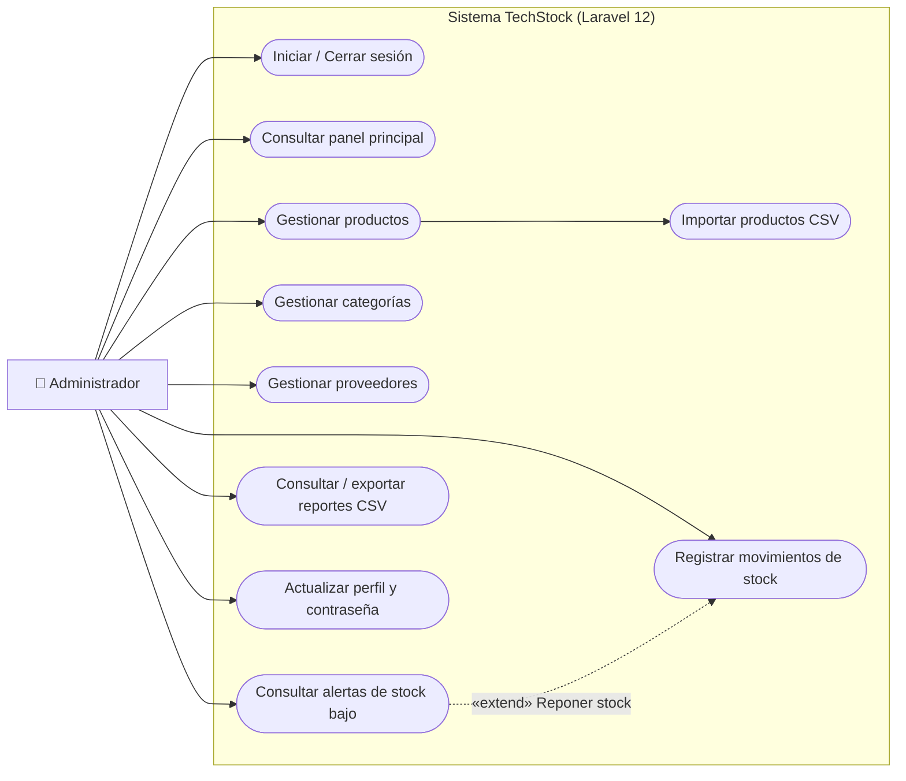
*Figura UML 1. Diagrama general de casos de uso verificado.*

---

#### C.2. Diagrama de actividad: registrar producto (`UML 2`)
Representa la captura de datos en `/products`, la validación del servidor en `ProductController@store`, la creación transaccional del producto junto con su movimiento inicial de inventario (cuando `stock > 0`) y la retroalimentación en la interfaz.

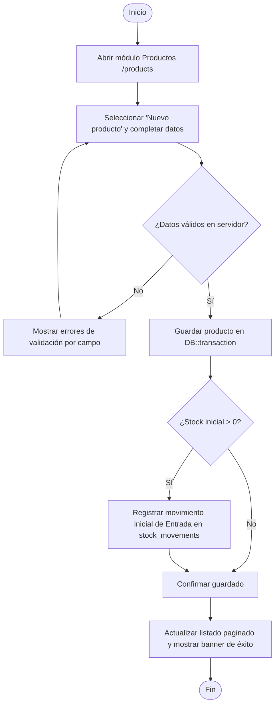
*Figura UML 2. Diagrama de actividad: registrar producto.*

---

#### C.3. Diagrama de actividad: registrar entrada o salida de stock (`UML 3`)
Modela la validación de disponibilidad de stock en salidas y la actualización atómica con `lockForUpdate()` en `StockMovementController@store`.

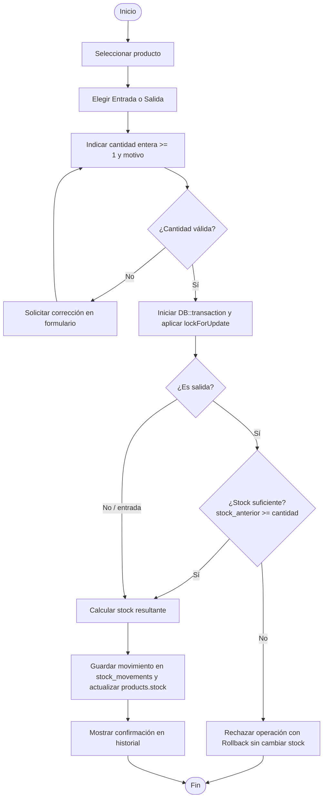
*Figura UML 3. Diagrama de actividad: registrar entrada o salida.*

---

#### C.4. Diagrama de clases verificado (`UML 4`)
Las clases `User`, `Category`, `Supplier`, `Product` y `StockMovement` corresponden exactamente a los modelos Eloquent implementados en `app/Models/`.

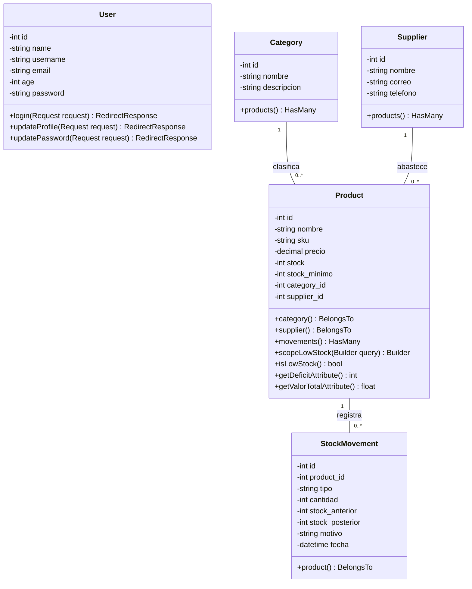
*Figura UML 4. Diagrama de clases verificado con los modelos Eloquent del proyecto.*

---

#### C.5. Diagrama de componentes / arquitectura (`UML 5`)
Representa la arquitectura en capas implementada en el repositorio Laravel 12.

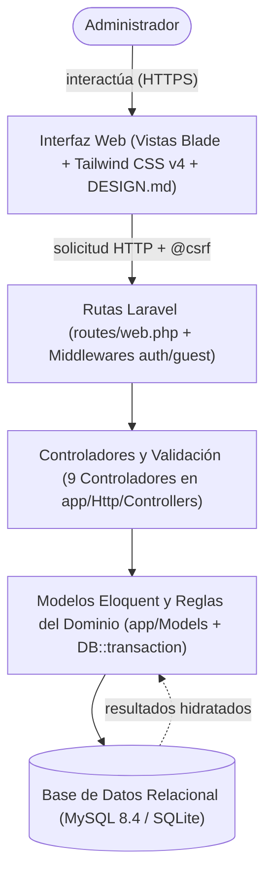
*Figura UML 5. Diagrama de componentes / arquitectura.*

---

#### C.6. Diagrama de estados: condición de stock (`UML 6`)
Modela las transiciones de estado de disponibilidad de un producto según la comparación entre `stock` y `stock_minimo`.

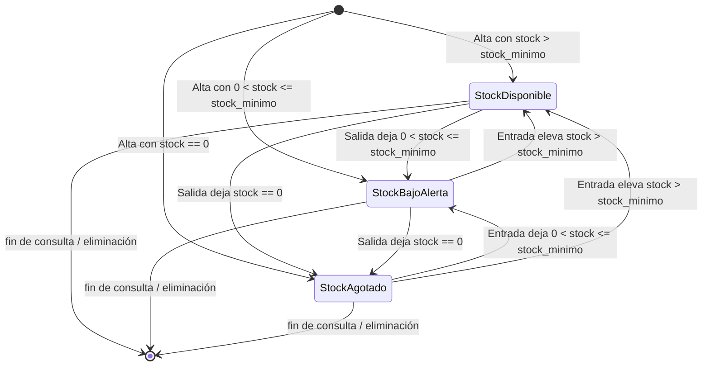
*Figura UML 6. Diagrama de estados: condición de stock.*

---

#### C.7. Diagrama de secuencia: registro de movimiento (`UML 7`)
Muestra la secuencia real verificada en `StockMovementController::store` incluyendo el bloqueo pesimista `SELECT ... FOR UPDATE` y la transacción atómica.

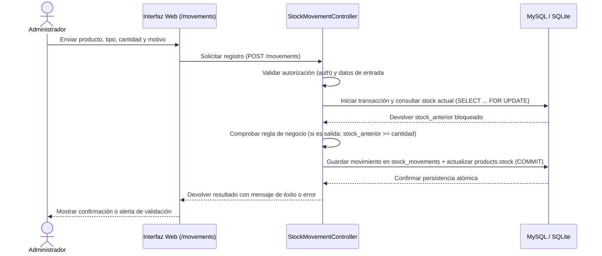
*Figura UML 7. Diagrama de secuencia: registro de movimiento.*

---

#### C.8. Nota de validación de los diagramas UML
Todos los diagramas UML incluidos en este documento (y en los capítulos III y IV) han sido verificados contra la implementación real del proyecto **TechStock** en Laravel 12:
1. Las multiplicidades del diagrama de clases (`1` a `0..*`) y sus políticas de borrado (`restrictOnDelete` en `categories` y `suppliers`; `cascadeOnDelete` en `stock_movements`) coinciden exactamente con la migración [2026_10_28_000001_create_inventory_tables.php](file:///c:/Users/USER/Desktop/laravel-projects/lpsenati_project/database/migrations/2026_10_28_000001_create_inventory_tables.php).
2. La atomicidad de los movimientos mediante `DB::transaction()` y `lockForUpdate()` corresponde a la implementación de [StockMovementController.php](file:///c:/Users/USER/Desktop/laravel-projects/lpsenati_project/app/Http/Controllers/StockMovementController.php).
3. El criterio de generación de alertas (`stock <= stock_minimo`) corresponde al método `scopeLowStock()` definido en [Product.php](file:///c:/Users/USER/Desktop/laravel-projects/lpsenati_project/app/Models/Product.php).
4. Todos los diagramas están escritos en código **Mermaid** nativo dentro de bloques ```` ```mermaid ````, lo que permite su renderizado directo en GitHub, GitLab, VS Code, Notion y exportadores académicos sin requerir herramientas externas.
